# Panduan Penggunaan SambungDulur

Panduan ini membawa Anda dari layar pertama sampai mengekspor pohon keluarga. Setiap bagian memuat **langkah**, **screenshot beranotasi**, dan **keterangan nomor**: lingkaran merah bernomor pada gambar menunjuk bagian layar yang dijelaskan di bawahnya.

> Semua gambar memakai **data fiktif** (`demo/keluarga-contoh.ged`, keluarga "Santoso", 14 orang, 4 generasi). Anda bisa mengikuti panduan ini dengan membuka file itu sendiri. Gambar dibuat otomatis oleh `npm run docs`, jadi selalu sesuai dengan versi aplikasi saat ini.

## Video demo

**[▶ Tonton video demo (3 menit 20 detik)](video/sambungdulur-demo.mp4)**: rekaman aplikasi sungguhan dengan narasi suara Microsoft Andika dan subtitle ([`.srt`](video/sambungdulur-demo.id.srt)). Naskah dan cara membuat ulang: [video/README.md](video/README.md).

**Daftar isi**
1. [Memulai](#1-memulai)
2. [Mengenal layar](#2-mengenal-layar)
3. [Mengubah data seseorang](#3-mengubah-data-seseorang)
4. [Menambah kerabat](#4-menambah-kerabat)
5. [Foto](#5-foto)
6. [Menghapus orang (dan aturannya)](#6-menghapus-orang-dan-aturannya)
7. [Membuka berkas (GEDCOM, MyHeritage, .sambung)](#7-membuka-berkas)
8. [Menjelajah pohon besar: generasi dan pencarian](#8-menjelajah-pohon-besar)
9. [Mengatur tampilan](#9-mengatur-tampilan)
10. [Tata letak manual](#10-tata-letak-manual)
11. [Menyimpan dan mengekspor](#11-menyimpan-dan-mengekspor)
12. [Bahasa](#12-bahasa)
13. [Di ponsel, dan memasang sebagai aplikasi](#13-di-ponsel-dan-memasang-sebagai-aplikasi)
14. [Tips dan pemecahan masalah](#14-tips-dan-pemecahan-masalah)

---

## 1. Memulai

| Cara | Langkah |
|---|---|
| **Online** | Buka alamat GitHub Pages proyek ini di Chrome atau Edge. |
| **Lokal** | `npm install`, lalu `npm run dev` dan buka `http://127.0.0.1:5173`. Untuk hasil build: `npm run build` lalu `npm run preview`. |
| **Pasang sebagai aplikasi** | Klik **Pasang** di toolbar (atau menu browser *Install app*). Di iPhone/iPad: Safari → Bagikan → *Add to Home Screen*. |

Tidak ada login. Data Anda **tidak dikirim ke mana pun**: semuanya tersimpan di browser dan baru menjadi file bila Anda menekan **Simpan** atau **Ekspor**.

---

## 2. Mengenal layar

Aplikasi dibuka dengan pohon awal tiga orang (saya, ayah, ibu) dan "Saya" sudah terpilih.

| No | Bagian | Fungsi |
|---|---|---|
| 1 | **Pop-up penyunting** | Terbuka di samping kartu orang terpilih dan berisi datanya, tombol **Ubah data**, **Tambah kerabat**, dan **Hapus orang**. Tombol yang tidak bisa dipakai menuliskan alasannya (mis. *Orang tua sudah ada*). Kanvas tetap bisa diklik dan digeser selama pop-up terbuka. Pop-up bisa **disematkan** menjadi panel tetap di kanan (bagian 3). Di tablet penyunting menjadi laci di kiri; di ponsel menjadi lembar bawah (bagian 13). |
| 2 | **Buka** | Membuka/mengimpor `.sambung`, `.ged`, atau `.zip`; menautkan folder foto. |
| 3 | **Simpan** (Ctrl+S) | Mengunduh file `.sambung` yang bisa dibuka ulang. |
| 4 | **Ekspor** | PNG, JPEG, SVG, GEDCOM, dan dokumen silsilah teks. |
| 5 | **Cari** (Ctrl+F) | Mencari orang berdasarkan nama, tahun, tempat, pekerjaan, atau ID. |
| 6 | **Generasi ▲/▼** | Berapa generasi leluhur (▲) dan keturunan (▼) yang ditampilkan. |
| 7 | **Pengaturan pohon** | Format tanggal, ukuran huruf, kolom kartu, tema, bahasa. |
| 8 | **Tata letak manual** | Menggeser kartu dan garis secara manual. |
| 9 | **Kartu orang** | Klik/ketuk untuk memilih; klik ganda untuk langsung mengubah data. **Klik kanan** (atau **tekan lama** di layar sentuh, atau tombol **⋯** di sudut kartu terpilih) membuka menu aksi (bagian 4). Kartu terpilih diberi sorotan **nila**, dan garis keturunannya ikut menyala; hasil pencarian diberi bingkai **sogan** (cokelat keemasan). Cincin foto: **biru = laki-laki, magenta = perempuan, teal putus-putus = lainnya**. |
| 10 | **Kontrol kanvas** | Pusatkan pohon, perbesar, perkecil. Roda mouse, seret, dan cubit (pinch) juga bekerja. |
| 11 | **Panduan (?)** | Membuka panduan ini di GitHub (butuh internet; aplikasi sendiri tetap berjalan luring). |

Arahkan mouse ke tombol ikon untuk melihat namanya beserta pintasan keyboard-nya. Tekan **Ctrl+H** (atau **F1** / **?**) untuk daftar semua pintasan (bagian 8).

Warna aplikasi bertema **Nila & Sogan**: nila (biru keunguan dari pewarna alam batik) untuk tombol utama, pilihan aktif, dan sorotan; sogan (cokelat keemasan batik Solo/Yogya) untuk hal yang perlu perhatian, seperti hasil pencarian dan penanda *belum disimpan*. Ikon tombol yang sedang aktif (mis. pencarian terbuka, tata letak manual menyala) tampil terisi penuh.

Di bagian bawah kiri kanvas ada keterangan **"3/3 tampil"** (jumlah orang yang terlihat dari seluruh pohon), orang fokus, legenda warna cincin, dan persentase zoom.

---

## 3. Mengubah data seseorang

**Tujuan:** mengisi nama, tanggal lahir, tempat, pekerjaan, dan catatan.

**Langkah**
1. Klik kartu orang yang ingin diubah. Pop-up penyunting terbuka di samping kartu itu.
2. Tekan **Ubah data** di pop-up (atau tekan **Enter** / **E**, atau klik ganda kartunya).
3. Isi tab **Pribadi**, lalu pindah ke tab **Biografi** (**Alt+1 / Alt+2 / Alt+3** berpindah tab).
4. Tekan **Simpan** atau **Ctrl+Enter** dari kolom mana pun (atau **Batal** untuk membuang perubahan).

### Pop-up penyunting dan panel tersemat

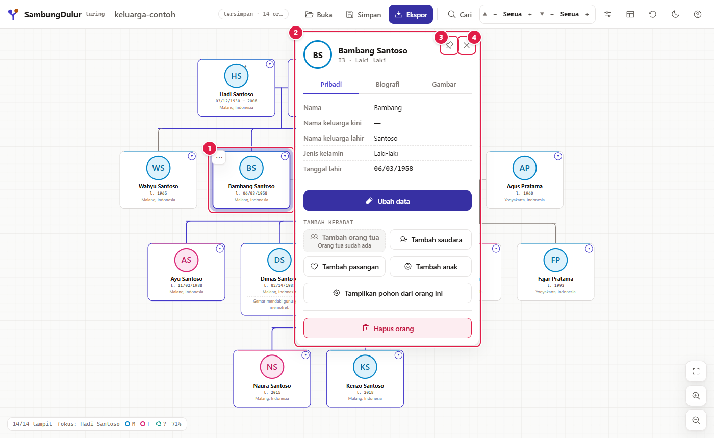

| No | Keterangan |
|---|---|
| 1 | Kartu orang terpilih. Pop-up tidak pernah menutupinya. |
| 2 | **Pop-up penyunting**: memilih sisi yang lapang (kanan, kiri, bawah, atau atas kartu), ikut bergeser saat kanvas digeser atau di-zoom, dan tersembunyi saat kartunya keluar layar. Klik kartu lain memindahkannya; klik bagian kosong kanvas menutupnya. Tombol panah tetap memindahkan pilihan, dan pop-up mengikuti. |
| 3 | **Sematkan**: mengubah pop-up menjadi panel tetap di kanan (gambar berikut). |
| 4 | **Tutup** (atau **Esc**). Fokus keyboard kembali ke kanvas. |

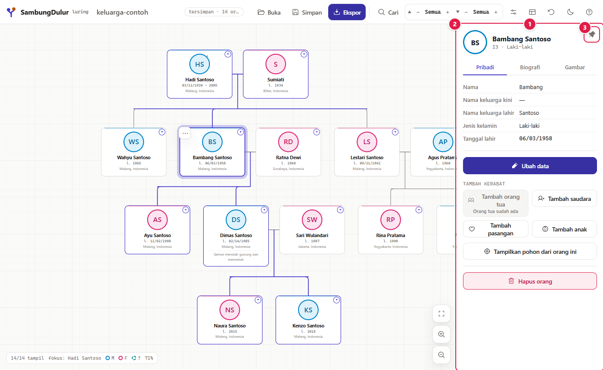

| No | Keterangan |
|---|---|
| 1 | **Panel tersemat** di kanan untuk sesi pengisian data yang panjang. Kanvas menyempit di sampingnya, jadi kartu tidak tertutup. Memilih orang lain hanya mengganti isinya. |
| 2 | Seret tepi kiri panel (atau fokuskan lalu pakai panah) untuk mengubah lebarnya. |
| 3 | **Lepas sematan**: kembali ke pop-up. Status sematan dan lebar panel diingat untuk kunjungan berikutnya. |

Bila Anda menutup penyunting atau memilih orang lain saat form berisi perubahan yang belum disimpan, aplikasi bertanya dulu:

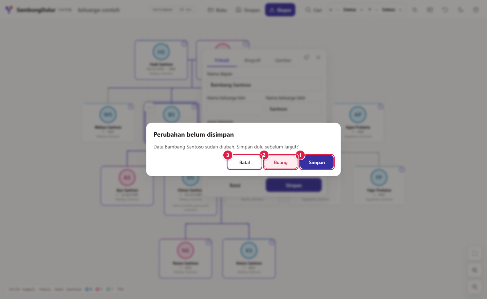

| No | Pilihan | Arti |
|---|---|---|
| 1 | **Simpan** | Menyimpan perubahan, lalu lanjut. |
| 2 | **Buang** | Membuang perubahan, lalu lanjut. |
| 3 | **Batal** | Tetap di form; isian tidak hilang. |

### Tab Pribadi

| No | Aksi |
|---|---|
| 1 | Tab **Pribadi** aktif. Tab dipertahankan saat berpindah antara mode lihat dan mode ubah. |
| 2 | Ketik **Nama depan** (contoh: `Dimas`). |
| 3 | Ketik **Nama keluarga kini**. **Nama keluarga lahir** (di sebelahnya) diisi bila berbeda, misalnya nama gadis. |
| 4 | Pilih **Jenis kelamin**: Perempuan, Laki-laki, atau Lainnya. Pilihan ini menentukan warna cincin foto. |
| 5 | Pilih **Tanggal lahir** lewat Hari / Bulan / Tahun. Boleh sebagian, misalnya hanya tahun. Untuk tanggal perkiraan, pilih *Tanggal perkiraan atau rentang…* dan tulis format GEDCOM seperti `ABT 1950` atau `BET 1900 AND 1910`. |
| 6 | Aktifkan **Telah wafat** untuk memunculkan isian **Tanggal wafat**. |
| 7 | **Simpan** menerapkan perubahan. |

### Tab Biografi

| No | Aksi |
|---|---|
| 1 | Berpindah ke tab **Biografi**. Isian di tab Pribadi tidak hilang. |
| 2 | **Negara / tempat lahir**. Muncul saran nama negara, tetapi teks bebas (mis. `Malang, Indonesia`) juga boleh. |
| 3 | **Pekerjaan**. |
| 4 | **Fakta menarik / biografi**: teks bebas, boleh beberapa baris. |
| 5 | **Simpan**. |

### Hasilnya

| No | Keterangan |
|---|---|
| 1 | Nama di kepala pop-up berubah. |
| 2 | Tabel **Personal** menampilkan data baru. Tanggal ditulis sesuai *Format tanggal* di Pengaturan pohon. |
| 3 | Kartu di kanvas ikut diperbarui. |

---

## 4. Menambah kerabat

**Tujuan:** menumbuhkan pohon dengan orang tua, saudara, pasangan, dan anak.

Pilih seseorang, lalu gunakan tombol di bagian **Tambah kerabat** (atau huruf pintasannya saat fokus di pohon).

| No | Tombol | Pintasan | Hasil |
|---|---|---|---|
| 1 | **Tambah orang tua** | **P** | Membuat ayah dan ibu baru ("Ayah dari …", "Ibu dari …"). **Nonaktif** bila orang itu sudah punya orang tua; lewat pintasan, alasannya muncul sebagai pemberitahuan singkat. |
| 2 | **Tambah saudara** | **S** | Menambah saudara kandung di keluarga orang tua yang sama. Bila orang tua belum ada, keduanya dibuat otomatis. |
| 3 | **Tambah pasangan** | **A** | Menambah pasangan berjenis kelamin berlawanan, ditempatkan di samping. Maksimal 20 pasangan per orang. |
| 4 | **Tambah anak** | **C** | Membuka dialog pilihan (di bawah). |
| 5 | | | Orang baru langsung terpilih, pop-up pindah ke kartunya, dan kanvas berpindah ke sana. Contoh: "Pasangan dari Dimas". |

Setelah menambah, ubah nama dan datanya dengan **Ubah data** (bagian 3).

### Menu aksi kartu

Semua aksi di atas juga tersedia langsung dari pohon, tanpa ke panel.

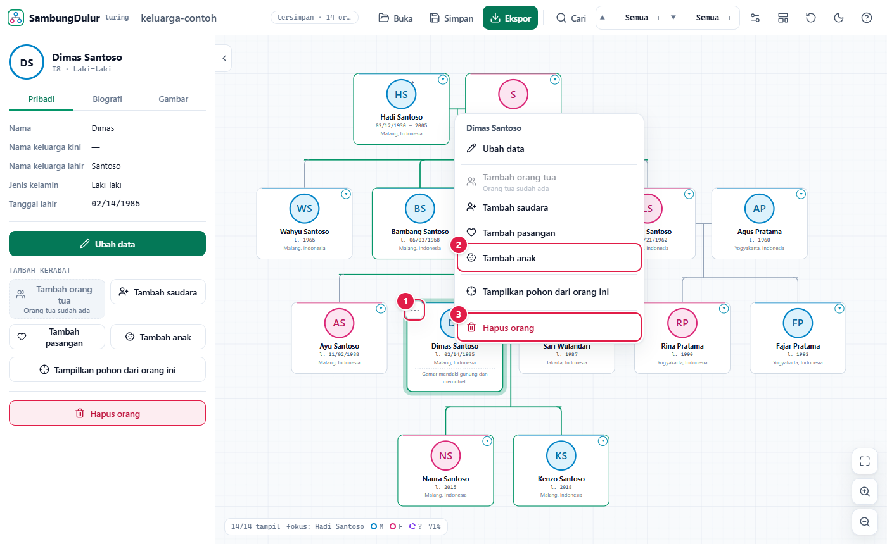

| No | Keterangan |
|---|---|
| 1 | Tombol **⋯** di sudut kartu terpilih. Bisa juga **klik kanan** kartu mana pun, atau **tekan lama** di layar sentuh. |
| 2 | Pilih aksi, mis. **Tambah anak**. Aksi yang tidak tersedia tetap tercantum beserta alasannya. Di sisi kanan tiap item tertulis pintasannya, sehingga Anda bisa belajar sambil bekerja. |
| 3 | **Hapus orang** dipisahkan di bagian bawah. |

### Salah langkah? Urungkan

Setiap perubahan pada isi pohon bisa diurungkan: **Ctrl+Z** untuk urungkan dan **Ctrl+Shift+Z** (atau Ctrl+Y) untuk ulangi. Setelah menghapus seseorang, muncul pemberitahuan dengan tombol **Urungkan** yang mengembalikan orang itu beserta hubungannya. Membuka berkas baru memulai riwayat baru.

### Dialog Tambah anak

| No | Pilihan | Arti |
|---|---|---|
| 1 | **Tambah anak dengan *nama pasangan*** | Anak dihubungkan ke orang ini dan pasangan yang sudah ada. Satu baris untuk tiap pasangan. |
| 2 | **Tambah anak dengan pasangan baru** | Orang tua lainnya dibuat sebagai orang baru. |
| 3 | **Tambah anak orang tua tunggal** | Hanya orang ini yang tercatat sebagai orang tua. |
| 4 | **Tambah** | Menyelesaikan. |

| No | Keterangan |
|---|---|
| 1 | Kartu anak baru muncul di bawah kedua orang tua, tersambung oleh garis keluarga. |
| 2 | Anak baru langsung terpilih, siap diberi nama. |

---

## 5. Foto

**Langkah**
1. Pilih orang, buka tab **Gambar** (atau tekan **I**, atau pilih **Unggah foto** di menu aksi kartu).
2. Tekan **Unggah gambar** dan pilih file (JPEG, PNG, WebP, atau HEIC bila didukung browser; maksimal 25 MB). Foto besar diperkecil otomatis dulu.
3. Geser gambar dan atur **Perbesaran** sampai wajah berada di tengah lingkaran.
4. Tekan **Pakai foto**. Pemberitahuan dengan tombol **Urungkan** (atau **Ctrl+Z**) mengembalikan foto lama.

| No | Aksi |
|---|---|
| 1 | Bidang potong berbentuk lingkaran. **Seret** untuk menggeser gambar. |
| 2 | Penggeser **Perbesaran**. |
| 3 | **Pakai foto** menyimpan hasil potongan 512×512 piksel. Foto hanya disimpan di perangkat ini. |

| No | Keterangan |
|---|---|
| 1 | Foto tampil di dalam cincin berwarna jenis kelamin. Tanpa foto, kartu menampilkan inisial. |
| 2 | **Hapus gambar** (dengan konfirmasi). **Ganti gambar** muncul menggantikan tombol Unggah. |

### Memotret langsung di ponsel

Di layar sentuh, tab **Gambar** punya dua tombol. Hasilnya masuk ke dialog potong yang sama.

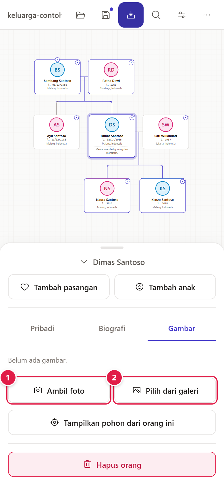

| No | Keterangan |
|---|---|
| 1 | **Ambil foto** membuka aplikasi kamera perangkat dengan kamera belakang (cocok untuk memotret foto cetak lama); kamera depan tetap bisa dipilih di aplikasi kamera. Menu aksi kartu juga punya **Ambil foto**. |
| 2 | **Pilih dari galeri** untuk foto yang sudah ada. |

Foto tidak pernah dikirim ke mana pun; pemotretan juga berjalan tanpa internet. Membatalkan dialog potong tidak mengubah foto lama.

---

## 6. Menghapus orang (dan aturannya)

**Langkah:** pilih orang → **Hapus orang** → konfirmasi **Hapus**.

Aplikasi menolak dua keadaan, dengan penjelasan:
- **Orang terakhir** tidak bisa dihapus (pohon harus berisi minimal satu orang).
- Orang yang **menghubungkan dua bagian pohon** tidak bisa dihapus karena pohon akan terpecah. Hapus dulu orang di cabang terluar.

| No | Keterangan |
|---|---|
| 1 | Dialog penjelasan. Dalam contoh ini Dimas menghubungkan orang tuanya dengan pasangan dan anaknya, sehingga menghapusnya akan memecah pohon. Tekan **OK**, lalu hapus dulu cabang terluar (misalnya anak). |

---

## 7. Membuka berkas

Tekan **Buka**.

| No | Pilihan | Untuk |
|---|---|---|
| 1 | **Buka file…** | `.sambung` (simpanan aplikasi ini), `.ged` (GEDCOM 5.5/5.5.1, UTF-8), `.zip` cadangan MyHeritage Family Tree Builder (berisi `Database/*.ftb`), atau `.zip` berisi `.ged` dan foto. |
| 2 | **Tautkan folder foto…** | GEDCOM hanya menyimpan *lokasi* foto. Pilih folder fotonya (mis. `*_Photos`) dan foto dicocokkan lewat nama file. Tersedia juga *Tautkan file foto satu per satu* untuk browser tanpa pemilih folder. |
| 3 | **Mulai pohon baru** | Kembali ke pohon awal tiga orang. |

Pilih `keluarga-contoh.ged` (ada di `docs/demo`). Aplikasi menampilkan **laporan impor**:

| No | Keterangan |
|---|---|
| 1 | Jumlah orang, keluarga, record lain yang disimpan apa adanya, dan jumlah foto yang dirujuk. Untuk cadangan MyHeritage `.zip`, laporan juga menyebut data yang **tidak** diimpor. |

**Hal penting tentang berkas**
- **GEDCOM dibuka secara lossless.** Tag yang tidak ditampilkan aplikasi (RESI, MARR, `_UID`, sumber, dll.) tetap ada dan ikut tertulis saat ekspor. Hanya bagian yang Anda ubah yang ditulis ulang.
- **`.ftb` hanya dibaca.** File MyHeritage tidak pernah diubah. Simpan hasil edit sebagai `.sambung` atau ekspor GEDCOM.
- File ANSEL tidak didukung. Ekspor ulang dari program asal sebagai UTF-8.

---

## 8. Menjelajah pohon besar

### Pohon lengkap

| No | Keterangan |
|---|---|
| 1 | Generasi paling atas (Hadi dan Sumiati). Tanda † pada cincin menandakan telah wafat. |
| 2 | **Orang terpilih** (Dimas): kartunya disorot dan garis ke leluhur serta keturunannya menyala nila. |
| 3 | Keturunan di generasi paling bawah. |
| 4 | Penghitung: **14/14 tampil** (semua orang terlihat) dan fokus saat ini. |

Kartu punya tombol kecil: **▾** meringkas rincian kartu, **+/−** di tepi atas atau bawah membuka atau menutup cabang orang tua atau anak.

### Mengatur jumlah generasi

Untuk pohon besar, batasi generasi supaya kartu tetap terbaca.

**Langkah**
1. Pilih orang, tekan **Tampilkan pohon dari orang ini** (menjadikannya pusat pohon).
2. Atur ▲ (leluhur) dan ▼ (keturunan) dengan tombol **−** / **+**. Urutannya 0, 1, 2 … 10, lalu **Semua**.

| No | Keterangan |
|---|---|
| 1 | Kontrol generasi. |
| 2 | **▲ 1** = satu generasi leluhur (orang tua Dimas, Bambang dan Ratna). |
| 3 | **▼ 1** = satu generasi keturunan (Naura dan Kenzo). |
| 4 | Penghitung menjadi **7/14 tampil**. |
| 5 | Dimas adalah orang fokus. Pasangan dan saudara ikut tampil. |

Pengaturan yang sama berlaku untuk **ekspor** bila Anda memilih *Tampilan saat ini*.

### Pintasan keyboard

Tekan **Ctrl+H** kapan saja untuk melihat daftar pintasan dalam bahasa yang dipilih. **F1** dan **?** membuka daftar yang sama. Di Mac, semua pintasan Ctrl juga bekerja dengan **⌘** dan ditampilkan sebagai ⌘.

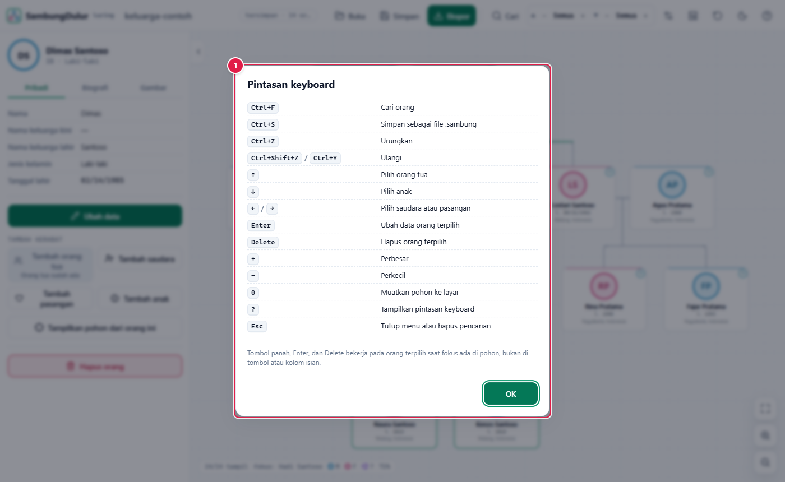

| No | Keterangan |
|---|---|
| 1 | **Kotak saring**: ketik kata (mis. `generasi`) atau tombol (mis. `ctrl+o`) untuk menyaring baris. |
| 2 | Pintasan dikelompokkan: **Berkas, Navigasi, Orang, Tampilan, Riwayat, Bantuan**. |
| 3 | Satu aksi bisa punya beberapa tombol, mis. **Enter / E** untuk *Ubah data*. |

Saat fokus ada di pohon (klik bagian kosong kanvas, atau tekan Tab sampai kanvas bergaris nila) atau di penyunting:

| Pintasan | Aksi |
|---|---|
| **Ctrl+H**, **F1**, **?** | Daftar pintasan |
| **Ctrl+O** / **Ctrl+S** / **Ctrl+E** | Buka / Simpan / Ekspor |
| **Ctrl+F** atau **Ctrl+K** | Cari orang |
| **↑ ↓ ← →** | Pilih orang tua, anak, saudara/pasangan |
| **Home** | Pilih orang fokus |
| **[** / **]** | Orang sebelumnya / berikutnya menurut urutan daftar orang di berkas |
| **Enter** atau **E** | Ubah data orang terpilih |
| **P** / **S** / **A** / **C** | Tambah orang tua / saudara / pasangan / anak |
| **F** | Tampilkan pohon dari orang ini |
| **I** | Ambil atau unggah foto |
| **Delete** | Hapus orang terpilih (dengan konfirmasi) |
| **Alt+1** / **Alt+2** / **Alt+3** | Tab Pribadi / Biografi / Gambar |
| **Ctrl+Enter** | Simpan form ubah data dari kolom mana pun |
| **+** / **−** / **0** | Perbesar / perkecil / muatkan pohon |
| **Ctrl+,** | Pengaturan pohon |
| **Ctrl+Shift+L** | Ganti tema terang/gelap |
| **M** | Tata letak manual nyala/mati |
| **Ctrl+↑** / **Ctrl+↓** | Tambah / kurangi satu generasi leluhur |
| **Ctrl+Shift+↑** / **Ctrl+Shift+↓** | Tambah / kurangi satu generasi keturunan |
| **Ctrl+Z** / **Ctrl+Shift+Z** (Ctrl+Y) | Urungkan / ulangi |
| **Esc** | Tutup menu, pop-up, atau sorotan pencarian |

Huruf tunggal berasal dari kata bahasa Inggris (**P**arents, **S**ibling, p**A**rtner, **C**hild, **E**dit, **F**ocus, **I**mage, **M**anual), jadi sama di semua bahasa. Pintasan tidak aktif saat Anda sedang mengetik di kolom isian, dan tidak bekerja di belakang dialog yang terbuka. Aksi yang tidak tersedia memunculkan pemberitahuan berisi alasannya.

### Mencari orang

Tekan ikon kaca pembesar, **Ctrl+F**, atau **Ctrl+K**.

| No | Keterangan |
|---|---|
| 1 | Ketik sebagian nama, tahun, tempat, pekerjaan, atau ID. Semua kata harus cocok; huruf besar-kecil dan tanda aksen diabaikan. Contoh `mal` menemukan semua orang kelahiran Malang. |
| 2 | Jumlah hasil dari total orang. |
| 3 | Daftar hasil dengan bagian yang cocok disorot. Gunakan **↑ ↓** lalu **Enter**, atau klik. |

Memilih hasil memusatkan kanvas pada orang itu. Bila orang tersebut berada di luar generasi yang sedang tampil, pohon dipindahkan agar ia menjadi pusat.

| No | Keterangan |
|---|---|
| 1 | Kartu hasil pencarian (Naura) dipusatkan dan diberi warna sorotan. |
| 2 | Datanya langsung terbuka di pop-up penyunting di sampingnya. **Esc** menghapus sorotan pencarian. |

---

## 9. Mengatur tampilan

Tekan ikon **Pengaturan pohon** (geser-geser).

| No | Pengaturan | Pilihan |
|---|---|---|
| 1 | **Format tanggal** | `MM/DD/YYYY`, `MM.DD.YYYY`, `DD/MM/YYYY`, `DD.MM.YYYY`, `YYYY` |
| 2 | **Ukuran huruf** | Kecil, Normal, Besar. Pada **Besar**, *Pekerjaan* dan *Fakta menarik* otomatis dinonaktifkan. |
| 3 | **Gaya pohon** | **Polos** atau **Berbingkai** (bingkai ganda di sekeliling kartu, terlihat pada gambar). |
| 4 | **Kolom kartu** | Tanggal lahir, tanggal wafat, negara lahir, gambar, pekerjaan, fakta menarik. Mematikan *Tanggal lahir* ikut mematikan *Tanggal wafat*. |
| 5 | **Tema** | Terang atau Gelap. |
| 6 | **Bahasa** | Indonesia, Jawa, atau Inggris. |
| 7 | **Animasikan garis keturunan terpilih** | Garis ke leluhur dan keturunan orang terpilih bergerak pelan. Hanya aktif bila Anda menyalakannya di sini (juga saat sistem meminta *kurangi gerakan*). |

Di dalam menu ini juga ada kontrol **Generasi**, selain di toolbar. Pengaturan disimpan bersama pohon.

### Latar kanvas

Bagian **Latar kanvas** di Pengaturan pohon mengganti latar di belakang kartu: **Kisi** (bawaan), **Polos**, **Motif**, atau **Gambar**. Perubahan langsung terlihat di kanvas, bisa diurungkan dengan **Ctrl+Z**, disimpan bersama pohon (ikut di berkas `.sambung`, termasuk gambarnya), dan bisa ikut diekspor. Garis keluarga dan bayangan kartu otomatis memakai warna terang atau gelap supaya tetap terlihat di latar apa pun. **Kembali ke bawaan** mengembalikan kisi.

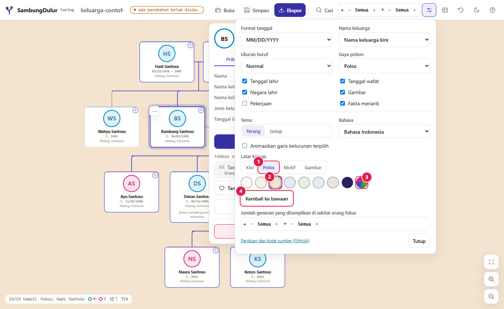

| No | Keterangan |
|---|---|
| 1 | Pilihan **Polos**. |
| 2 | Delapan warna siap pakai yang serasi dengan palet (di tema gelap memakai varian gelapnya), mis. *Sogan muda*. |
| 3 | **Warna lain**: pemilih warna bebas. |
| 4 | **Kembali ke bawaan** (kisi). |

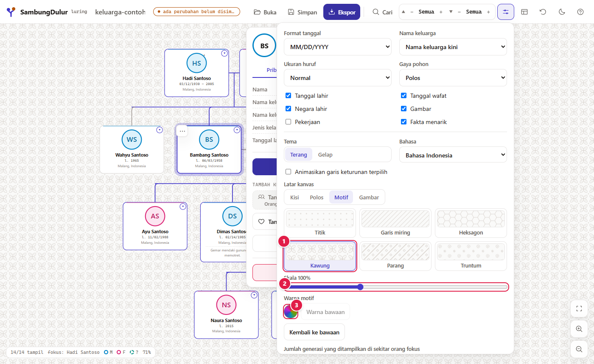

| No | Keterangan |
|---|---|
| 1 | Enam motif ubin: **Titik**, **Garis miring**, **Heksagon**, serta tafsiran geometris sederhana atas batik **Kawung**, **Parang**, dan **Truntum**. Contoh kecil di tiap tombol memperlihatkan polanya. |
| 2 | **Skala** 50–200 %. |
| 3 | **Warna motif**; *Warna bawaan* kembali ke warna halus yang menyesuaikan tema. |

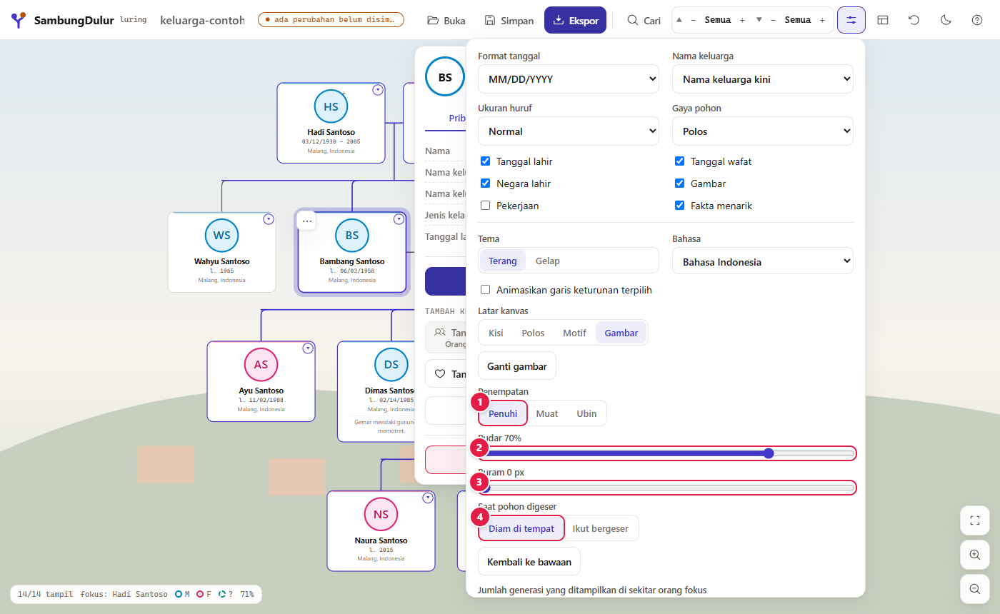

Pilih **Gambar**, lalu **Unggah gambar** (di ponsel: **Ambil foto** atau **Pilih dari galeri**), misalnya foto rumah atau kampung halaman. Gambar diperkecil otomatis (sisi terpanjang ±2560 px) supaya berkas tidak membengkak.

| No | Keterangan |
|---|---|
| 1 | **Penempatan**: **Penuhi** (menutup seluruh kanvas), **Muat** (seluruh gambar terlihat), atau **Ubin** (diulang). |
| 2 | **Pudar** 0–90 % (bawaan 70 %): lapisan warna tema di atas gambar supaya kartu tetap terbaca. |
| 3 | **Buram** 0–12 px. |
| 4 | Saat pohon digeser, gambar **Diam di tempat** atau **Ikut bergeser**. |

### Tema gelap

| No | Keterangan |
|---|---|
| 1 | Kartu orang terpilih dengan garis keturunan yang menyala. |
| 2 | Cincin perempuan (magenta) dan laki-laki (biru) tetap mudah dibedakan di tema gelap. |

Tombol bulan/matahari di toolbar mengganti tema dengan cepat.

---

## 10. Tata letak manual

Susunan kartu dihitung otomatis. Bila ingin menyesuaikan:

**Langkah**
1. Tekan **Tata Letak Manual** di toolbar.
2. Baca penjelasan, tunggu hitung mundur selesai, tekan **Lanjut**. (Penjelasan hanya muncul pada penggunaan pertama.)
3. Seret **pegangan ↔** di atas kartu untuk menggeser orang ke kiri atau kanan.
4. Seret **titik bulat** pada garis keluarga untuk menggeser garis naik atau turun.
5. Tekan **Simpan** untuk menerapkan, atau **Batal** untuk membuang.

| No | Keterangan |
|---|---|
| 1 | Dialog penjelasan. Tombol **Lanjut** aktif setelah hitung mundur 3 detik. |

| No | Keterangan |
|---|---|
| 1 | Pegangan **↔** pada kartu. Pada gambar, Fajar sudah digeser ke kanan (kartunya terangkat dan garis ikut menyesuaikan). |
| 2 | **Titik kontrol** garis keluarga: seret ke atas/bawah. |
| 3 | **Simpan**: nonaktif sampai ada perubahan. |
| 4 | **Batal**: kembali ke posisi sebelumnya. |

Tombol **M** menyalakan atau mematikan mode ini saat fokus di pohon. Pop-up penyunting ditutup selama mode ini supaya pegangan geser tidak tertutup dan tidak ada perubahan data yang bercampur. **Atur ulang tata letak manual** (di bilah atas) menghapus semua penyesuaian. Penyesuaian disimpan sebagai *selisih dari tata letak otomatis*, jadi tetap berlaku ketika Anda menambah orang kemudian.

---

## 11. Menyimpan dan mengekspor

### Simpan: format yang bisa dibuka ulang

Tekan **Simpan** (atau **Ctrl+S**). Browser mengunduh `<judul>.sambung`, berisi pohon, pengaturan, tata letak manual, foto, dan GEDCOM sumber (bila pohon berasal dari GEDCOM). Buka kembali lewat **Buka → Buka file…**: hasilnya persis seperti saat disimpan.

| No | Keterangan |
|---|---|
| 1 | Penanda status: *tersimpan* berarti tidak ada perubahan yang belum ditulis ke file. Bila tertulis *● ada perubahan belum disimpan ke file*, browser akan memperingatkan sebelum Anda menutup tab. |
| 2 | Pemberitahuan singkat di bawah layar. |

> Salinan kerja juga disimpan otomatis di browser (IndexedDB), sehingga reload atau menutup browser tidak menghilangkan pekerjaan. Itu **bukan** pengganti file: bersihkan data situs, dan salinannya hilang. Simpan `.sambung` secara berkala.

### Ekspor

Tekan **Ekspor**.

| No | Pilihan | Hasil |
|---|---|---|
| 1 | **Gambar PNG** | Gambar pohon. Juga tersedia **JPEG** (latar padat) dan **SVG** (vektor). |
| 2 | **GEDCOM 5.5.1** | `.ged` untuk program silsilah lain; opsi ZIP berisi folder `media/` untuk foto. |
| 3 | **Dokumen silsilah** | File teks biasa: leluhur bernomor, keturunan bertingkat, indeks nama. |
| 4 | **Orang yang disertakan** | *Tampilan saat ini* (mengikuti kontrol generasi) atau *Seluruh keluarga yang terhubung*. |
| 5 | **Rincian kartu** (untuk gambar) | **Ringkas / Normal / Rinci** (lihat di bawah). |
| 6 | **Ekspor** | Mengunduh file. |

Pengaturan gambar lain: **Latar** (**Ikuti latar kanvas** sebagai bawaan, termasuk warna, motif, atau gambar latar; **Putih**; atau **Transparan**, yang pada JPEG menjadi putih), **Resolusi** 1×–3× (otomatis diturunkan bila melebihi batas kanvas browser), dan **legenda jenis kelamin**.

#### PNG: Ringkas, Normal, Rinci

Ketiganya adalah ekspor `Seluruh keluarga yang terhubung` dari pohon contoh.

**Ringkas**: kartu kecil, hanya nama, tanggal, dan foto. Cocok untuk melihat bentuk pohon besar.

**Normal**: mengikuti *Pengaturan pohon* (kolom dan ukuran huruf yang sedang Anda pakai).

**Rinci**: semua kolom (tempat, pekerjaan, fakta) pada kartu lebih lebar. Cocok untuk dicetak.

#### GEDCOM dan dokumen teks

- Bila pohon berasal dari GEDCOM, ekspor **menulis ulang hanya orang dan keluarga yang Anda ubah**. Selebihnya identik byte-per-byte dengan file asal, termasuk tag yang tidak ditampilkan aplikasi.
- Contoh hasil: [`demo/contoh-ekspor.ged`](demo/contoh-ekspor.ged) dan [`demo/contoh-dokumen-silsilah.txt`](demo/contoh-dokumen-silsilah.txt).

---

## 12. Bahasa

Bahasa bawaan adalah **Indonesia**. Pilih **Basa Jawa** atau **English** di *Pengaturan pohon → Bahasa* (di layar lebar ≥1700 px juga ada pemilih di toolbar, dan di ponsel ada di menu ⋯).

| No | Keterangan |
|---|---|
| 1 | **Pengaturan pohon**, tempat pemilih **Bahasa** berada. Pilihan diingat untuk kunjungan berikutnya. |
| 2 | Seluruh label berganti: **Bukak**, **Simpen**, **Ekspor**. |
| 3 | Penyunting, pesan, nama otomatis ("Bapakné …", "Bojoné …"), nama bulan, dan teks dokumen silsilah mengikuti bahasa yang dipilih. |

Bahasa hanya mengubah tampilan; data keluarga Anda tidak berubah.

---

## 13. Di ponsel, dan memasang sebagai aplikasi

Pada layar sempit (≤760 px) tampilan menyesuaikan diri: panel editor menjadi **lembar bawah** yang bisa diseret, dan alat sekunder pindah ke menu **⋯**. Semua tombol berukuran minimal 44 px supaya mudah diketuk. Pada layar pertama muncul petunjuk singkat; ketuk **Mengerti** dan petunjuk itu tidak muncul lagi.

| No | Keterangan |
|---|---|
| 1 | **Buka**, **Simpan**, **Ekspor**, **Cari**, **Pengaturan**, dan **⋯** selalu terlihat di bilah atas. Titik pada tombol Simpan menunjukkan status: nila = tersimpan, sogan (cokelat keemasan) = ada perubahan yang belum disimpan ke file. |
| 2 | Menu **⋯** (gambar di bawah). |
| 3 | Bilah lembar penyunting berisi nama orang terpilih. Ketuk atau seret ke atas untuk membukanya. |
| 4 | Pusatkan, perbesar, perkecil. Cubit dengan dua jari untuk zoom, atau **ketuk dua kali** untuk memperbesar di titik itu. |
| 5 | Chip **▲ ▼**: jumlah generasi yang tampil. Ketuk untuk mengubahnya. |

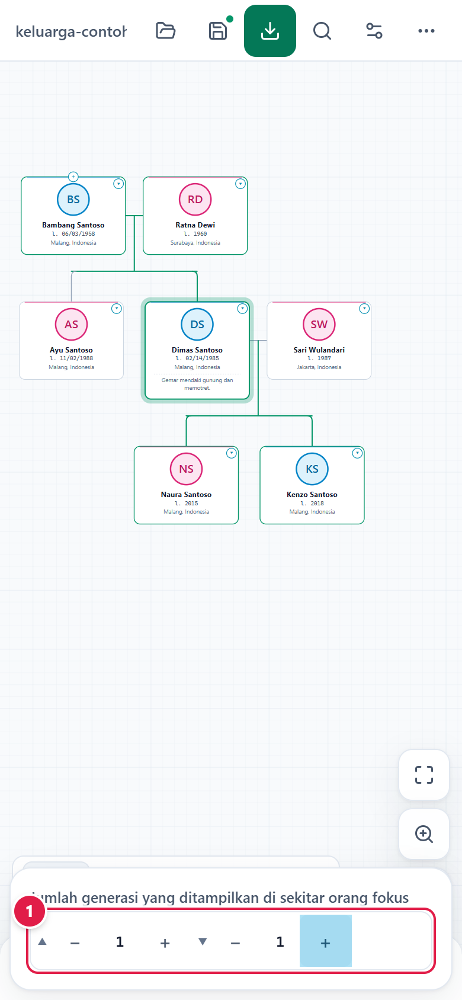

| No | Keterangan |
|---|---|
| 1 | Atur ▲ (leluhur) dan ▼ (keturunan). Di ponsel, batasi generasi (mis. ▲1 ▼1) supaya kartu terbaca. |

| No | Keterangan |
|---|---|
| 1 | Tata letak manual. |
| 2 | Ganti tema terang/gelap. |
| 3 | Bahasa. |
| 4 | **Atur ulang pohon** dipisahkan dari pengaturan tampilan dan selalu meminta konfirmasi. |

| No | Keterangan |
|---|---|
| 1 | Ketuk sebuah kartu: lembar terbuka setengah, dan kartu itu tetap terlihat di atasnya. |
| 2 | Seret lembar ke atas untuk tinggi penuh, ke bawah untuk kembali ke bilah. **Ubah data** membuka lembar penuh. Tombol **Kembali** di Android menutup lembar penuh atau dialog lebih dulu, tanpa keluar dari aplikasi. |
| 3 | **Tambah kerabat** langsung di bawah nama, jadi cukup satu ketukan. Ketuk bagian kosong pohon untuk menutup lembar. |

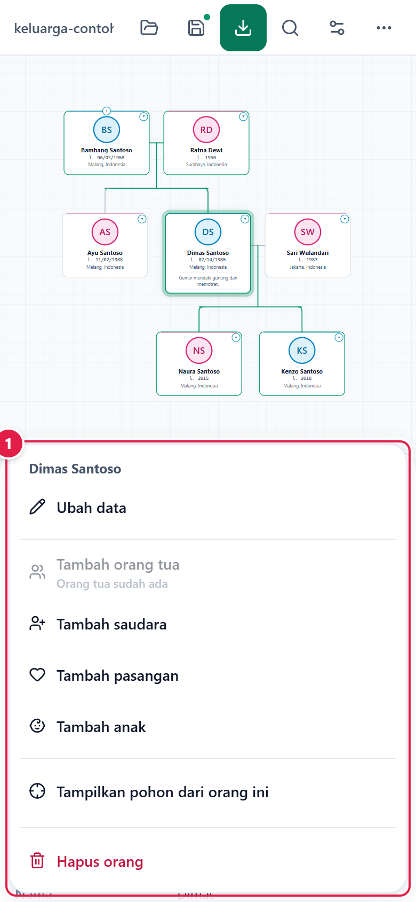

| No | Keterangan |
|---|---|
| 1 | **Tekan lama** sebuah kartu untuk menu aksinya, muncul dari bawah layar supaya terjangkau ibu jari. |

### Memasang dan memakai tanpa internet

1. Buka aplikasi sekali saat online. Service worker menyimpan semua file aplikasi.
2. Pasang (bagian 1). Aplikasi muncul di daftar program/layar utama dengan logo SambungDulur (anak pohon dengan dua simpul nila dan sogan) dan terbuka tanpa bilah alamat. Di Android 13 ke atas, ikonnya ikut tema ikon sistem bila diaktifkan.
3. Setelah itu, aplikasi berjalan **tanpa internet**: buka, edit, simpan, dan ekspor semuanya terjadi di perangkat.

---

## 14. Tips dan pemecahan masalah

| Masalah | Penyebab / solusi |
|---|---|
| Foto tidak muncul setelah membuka GEDCOM | GEDCOM hanya mencatat lokasi foto. Pakai **Buka → Tautkan folder foto…**. Foto yang belum tertaut ditandai di panel *Gambar*. |
| Sebuah tombol abu-abu | Alasannya tertulis di bawah label tombol, mis. *Orang tua sudah ada*. |
| Terhapus tanpa sengaja | Ketuk **Urungkan** pada pemberitahuan, atau tekan **Ctrl+Z**. |
| Tidak bisa menghapus seseorang | Aturan hapus (bagian 6). Hapus cabang terluar lebih dulu. |
| Pohon terlalu kecil/rapat | Kurangi generasi, atau pakai **Pusatkan**. Untuk ekspor, pakai preset **Ringkas** atau SVG. |
| Ekspor PNG gagal pada pohon sangat besar | Batas kanvas browser. Kurangi generasi atau ekspor **SVG**. |
| Karakter GEDCOM tampak rusak | Berkas bukan UTF-8. Aplikasi membaca sebagai Windows-1252 dan memberi peringatan. Ekspor ulang sebagai UTF-8 dari program asal. |
| Pekerjaan/fakta tidak tampil di kartu | Ukuran huruf **Besar** menyembunyikannya, atau kolomnya dimatikan di Pengaturan pohon. |
| Data hilang setelah membersihkan data situs | Salinan kerja ada di penyimpanan browser. Selalu simpan `.sambung` atau ekspor GEDCOM sebagai cadangan. |

**Batasan yang perlu diketahui**
- Kolom GEDCOM yang bisa diedit: nama, jenis kelamin, kelahiran (tanggal/tempat), kematian, pekerjaan, catatan pertama, foto utama, dan relasi keluarga. Lainnya dipertahankan tetapi tidak bisa diedit.
- Berkas MyHeritage `.ftb` hanya bisa **diimpor** (hanya-baca); fakta seperti tempat tinggal, pemakaman, dan pernikahan belum ikut diimpor.
- Selengkapnya ada di bagian *Batasan format* pada [README](../README.md).

---

*Mengulang pembuatan gambar panduan:* `npm run build`, jalankan `npx vite preview --port 4173`, lalu `npm run docs`. Skrip `scripts/make-docs.mjs` mengendalikan aplikasi dengan Edge, memakai data fiktif di `docs/demo`, dan menggambar penanda bernomor pada tiap screenshot.
