# Panduan Penggunaan SambungDulur

Panduan ini membawa Anda dari layar pertama sampai mengekspor pohon keluarga. Setiap bagian memuat **langkah**, **screenshot beranotasi**, dan **keterangan nomor**: lingkaran merah bernomor pada gambar menunjuk bagian layar yang dijelaskan di bawahnya.

> Semua gambar memakai **data fiktif** (`demo/keluarga-contoh.ged`, keluarga "Santoso", 14 orang, 4 generasi). Anda bisa mengikuti panduan ini dengan membuka file itu sendiri. Gambar dibuat otomatis oleh `npm run docs`, jadi selalu sesuai dengan versi aplikasi saat ini.

**Daftar isi**
1. [Memulai](#1-memulai)
2. [Mengenal layar](#2-mengenal-layar)
3. [Mengubah data seseorang](#3-mengubah-data-seseorang)
4. [Menambah kerabat](#4-menambah-kerabat)
5. [Foto](#5-foto)
6. [Menghapus orang (dan aturannya)](#6-menghapus-orang-dan-aturannya)
7. [Membuka berkas (GEDCOM, MyHeritage, .sambung)](#7-membuka-berkas)
8. [Menjelajah pohon besar: generasi dan pencarian](#8-menjelajah-pohon-besar)
9. [Mengatur tampilan](#9-mengatur-tampilan)
10. [Tata letak manual](#10-tata-letak-manual)
11. [Menyimpan dan mengekspor](#11-menyimpan-dan-mengekspor)
12. [Bahasa](#12-bahasa)
13. [Di ponsel, dan memasang sebagai aplikasi](#13-di-ponsel-dan-memasang-sebagai-aplikasi)
14. [Tips dan pemecahan masalah](#14-tips-dan-pemecahan-masalah)

---

## 1. Memulai

| Cara | Langkah |
|---|---|
| **Online** | Buka alamat GitHub Pages proyek ini di Chrome atau Edge. |
| **Lokal** | `npm install`, lalu `npm run dev` dan buka `http://127.0.0.1:5173`. Untuk hasil build: `npm run build` lalu `npm run preview`. |
| **Pasang sebagai aplikasi** | Klik **Pasang** di toolbar (atau menu browser *Install app*). Di iPhone/iPad: Safari → Bagikan → *Add to Home Screen*. |

Tidak ada login. Data Anda **tidak dikirim ke mana pun**: semuanya tersimpan di browser dan baru menjadi file bila Anda menekan **Simpan** atau **Ekspor**.

---

## 2. Mengenal layar

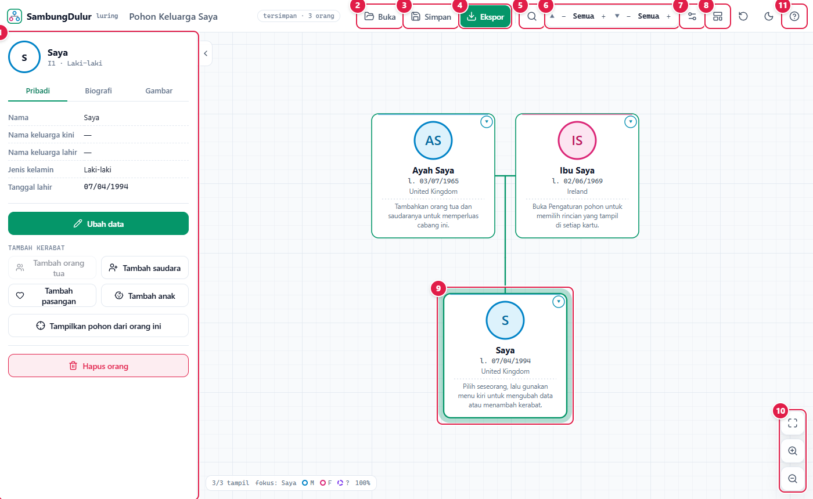

Aplikasi dibuka dengan pohon awal tiga orang (saya, ayah, ibu) dan "Saya" sudah terpilih.

| No | Bagian | Fungsi |
|---|---|---|
| 1 | **Panel editor** (kiri) | Menampilkan data orang terpilih, tombol **Ubah data**, **Tambah kerabat**, dan **Hapus orang**. Di ponsel berubah menjadi panel bawah. |
| 2 | **Buka** | Membuka/mengimpor `.sambung`, `.ged`, atau `.zip`; menautkan folder foto. |
| 3 | **Simpan** (Ctrl+S) | Mengunduh file `.sambung` yang bisa dibuka ulang. |
| 4 | **Ekspor** | PNG, JPEG, SVG, GEDCOM, dan dokumen silsilah teks. |
| 5 | **Cari** (Ctrl+F) | Mencari orang berdasarkan nama, tahun, tempat, pekerjaan, atau ID. |
| 6 | **Generasi ▲/▼** | Berapa generasi leluhur (▲) dan keturunan (▼) yang ditampilkan. |
| 7 | **Pengaturan pohon** | Format tanggal, ukuran huruf, kolom kartu, tema, bahasa. |
| 8 | **Tata letak manual** | Menggeser kartu dan garis secara manual. |
| 9 | **Kartu orang** | Klik/ketuk untuk memilih. Kartu terpilih diberi sorotan hijau, dan garis keturunannya ikut menyala. Cincin foto: **biru = laki-laki, magenta = perempuan, ungu putus-putus = lainnya**. |
| 10 | **Kontrol kanvas** | Pusatkan pohon, perbesar, perkecil. Roda mouse, seret, dan cubit (pinch) juga bekerja. |

Di bagian bawah kiri kanvas ada keterangan **"3/3 tampil"** (jumlah orang yang terlihat dari seluruh pohon), orang fokus, legenda warna cincin, dan persentase zoom.

---

## 3. Mengubah data seseorang

**Tujuan:** mengisi nama, tanggal lahir, tempat, pekerjaan, dan catatan.

**Langkah**
1. Klik kartu orang yang ingin diubah.
2. Tekan **Ubah data** di panel kiri.
3. Isi tab **Pribadi**, lalu pindah ke tab **Biografi**.
4. Tekan **Simpan** (atau **Batal** untuk membuang perubahan).

### Tab Pribadi

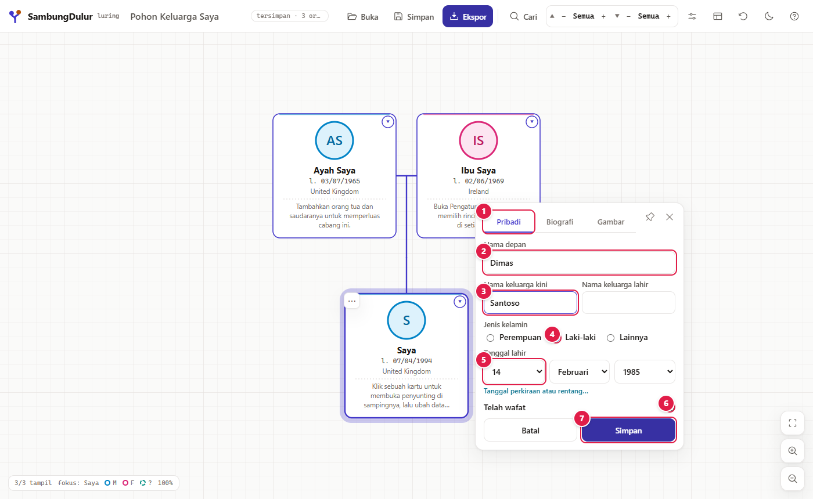

| No | Aksi |
|---|---|
| 1 | Tab **Pribadi** aktif. Tab dipertahankan saat berpindah antara mode lihat dan mode ubah. |
| 2 | Ketik **Nama depan** (contoh: `Dimas`). |
| 3 | Ketik **Nama keluarga kini**. **Nama keluarga lahir** (di sebelahnya) diisi bila berbeda, misalnya nama gadis. |
| 4 | Pilih **Jenis kelamin**: Perempuan, Laki-laki, atau Lainnya. Pilihan ini menentukan warna cincin foto. |
| 5 | Pilih **Tanggal lahir** lewat Hari / Bulan / Tahun. Boleh sebagian, misalnya hanya tahun. Untuk tanggal perkiraan, pilih *Tanggal perkiraan atau rentang…* dan tulis format GEDCOM seperti `ABT 1950` atau `BET 1900 AND 1910`. |
| 6 | Aktifkan **Telah wafat** untuk memunculkan isian **Tanggal wafat**. |
| 7 | **Simpan** menerapkan perubahan. |

### Tab Biografi

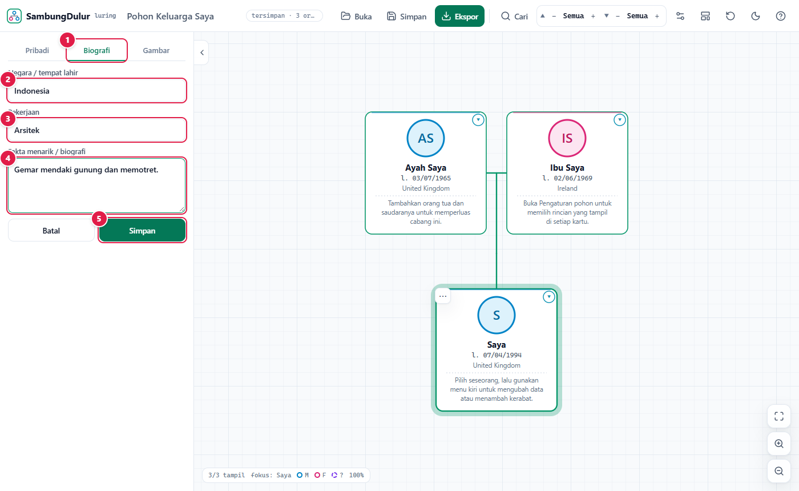

| No | Aksi |
|---|---|
| 1 | Berpindah ke tab **Biografi**. Isian di tab Pribadi tidak hilang. |
| 2 | **Negara / tempat lahir**. Muncul saran nama negara, tetapi teks bebas (mis. `Malang, Indonesia`) juga boleh. |
| 3 | **Pekerjaan**. |
| 4 | **Fakta menarik / biografi**: teks bebas, boleh beberapa baris. |
| 5 | **Simpan**. |

### Hasilnya

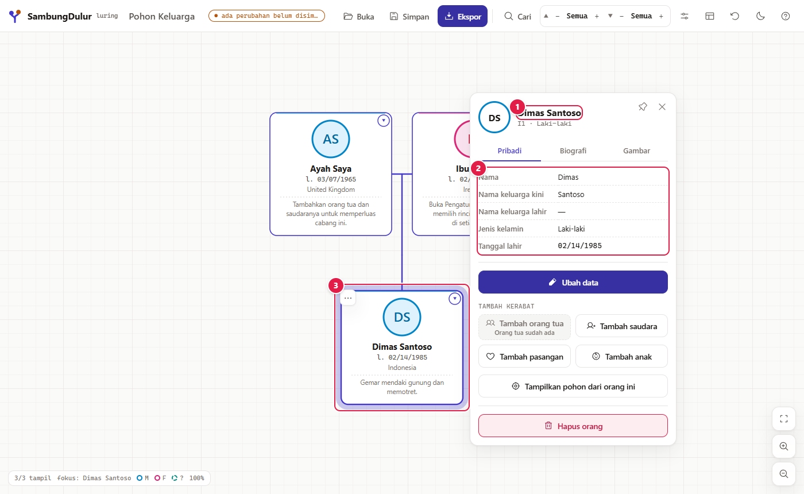

| No | Keterangan |
|---|---|
| 1 | Nama di kepala panel berubah. |
| 2 | Tabel **Personal** menampilkan data baru. Tanggal ditulis sesuai *Format tanggal* di Pengaturan pohon. |
| 3 | Kartu di kanvas ikut diperbarui. |

---

## 4. Menambah kerabat

**Tujuan:** menumbuhkan pohon dengan orang tua, saudara, pasangan, dan anak.

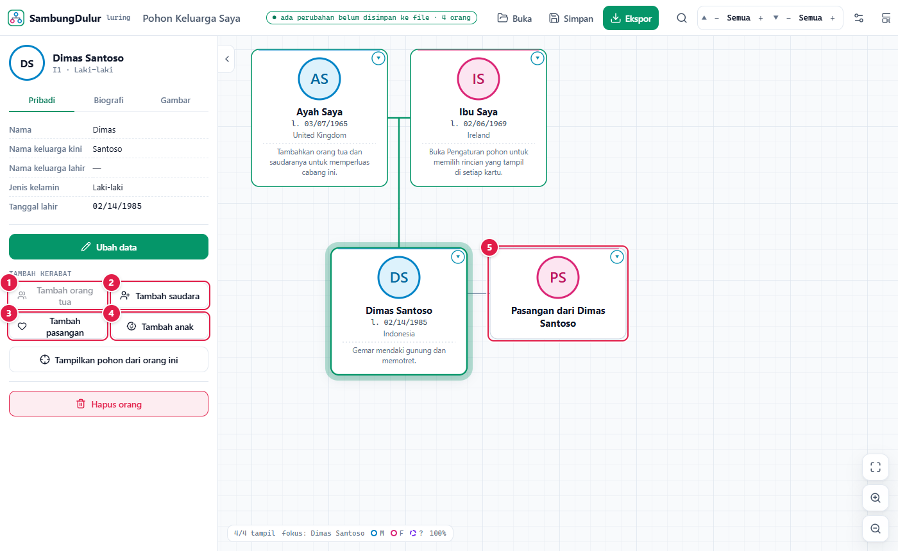

Pilih seseorang, lalu gunakan tombol di bagian **Tambah kerabat**.

| No | Tombol | Hasil |
|---|---|---|
| 1 | **Tambah orang tua** | Membuat ayah dan ibu baru ("Ayah dari …", "Ibu dari …"). **Nonaktif** bila orang itu sudah punya orang tua. |
| 2 | **Tambah saudara** | Menambah saudara kandung di keluarga orang tua yang sama. Bila orang tua belum ada, keduanya dibuat otomatis. |
| 3 | **Tambah pasangan** | Menambah pasangan berjenis kelamin berlawanan, ditempatkan di samping. Maksimal 20 pasangan per orang. |
| 4 | **Tambah anak** | Membuka dialog pilihan (di bawah). |
| 5 | Orang baru langsung terpilih dan kanvas berpindah ke sana. Contoh: "Pasangan dari Dimas". |

Setelah menambah, ubah nama dan datanya dengan **Ubah data** (bagian 3).

### Dialog Tambah anak

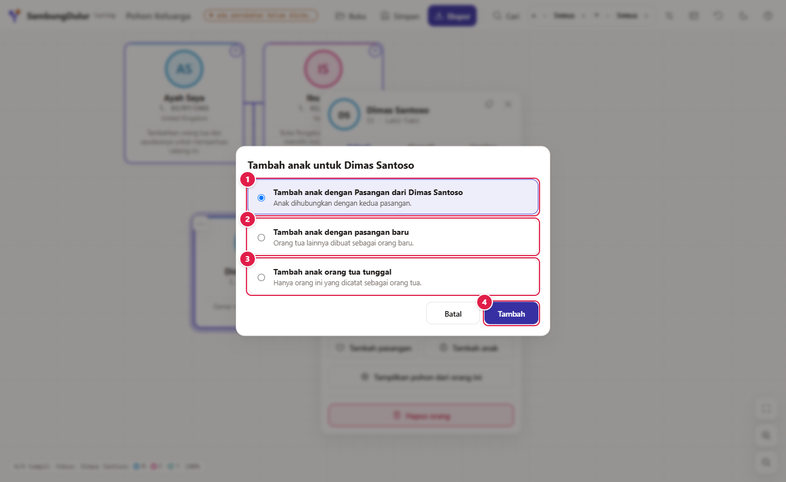

| No | Pilihan | Arti |
|---|---|---|
| 1 | **Tambah anak dengan *nama pasangan*** | Anak dihubungkan ke orang ini dan pasangan yang sudah ada. Satu baris untuk tiap pasangan. |
| 2 | **Tambah anak dengan pasangan baru** | Orang tua lainnya dibuat sebagai orang baru. |
| 3 | **Tambah anak orang tua tunggal** | Hanya orang ini yang tercatat sebagai orang tua. |
| 4 | **Tambah** | Menyelesaikan. |

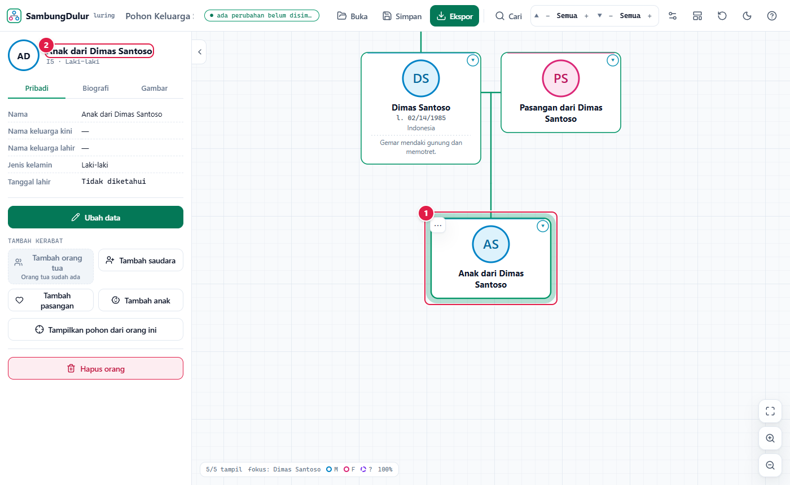

| No | Keterangan |
|---|---|
| 1 | Kartu anak baru muncul di bawah kedua orang tua, tersambung oleh garis keluarga. |
| 2 | Anak baru langsung terpilih, siap diberi nama. |

---

## 5. Foto

**Langkah**
1. Pilih orang, buka tab **Gambar**.
2. Tekan **Unggah gambar** dan pilih file (JPEG, PNG, WebP, atau HEIC bila didukung browser; maksimal 25 MB).
3. Geser gambar dan atur **Perbesaran** sampai wajah berada di tengah lingkaran.
4. Tekan **Pakai foto**.

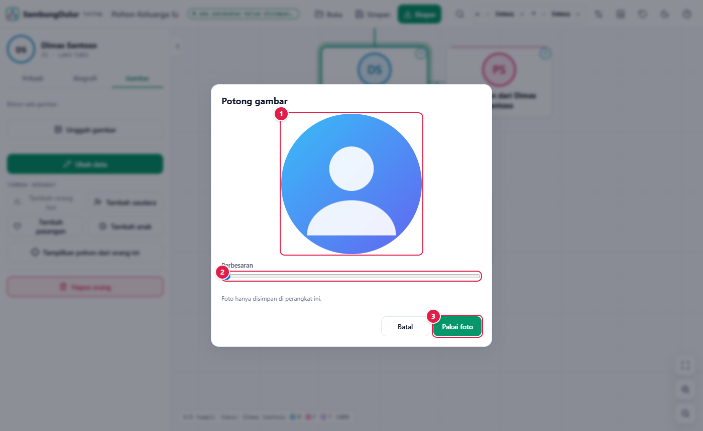

| No | Aksi |
|---|---|
| 1 | Bidang potong berbentuk lingkaran. **Seret** untuk menggeser gambar. |
| 2 | Penggeser **Perbesaran**. |
| 3 | **Pakai foto** menyimpan hasil potongan 512×512 piksel. Foto hanya disimpan di perangkat ini. |

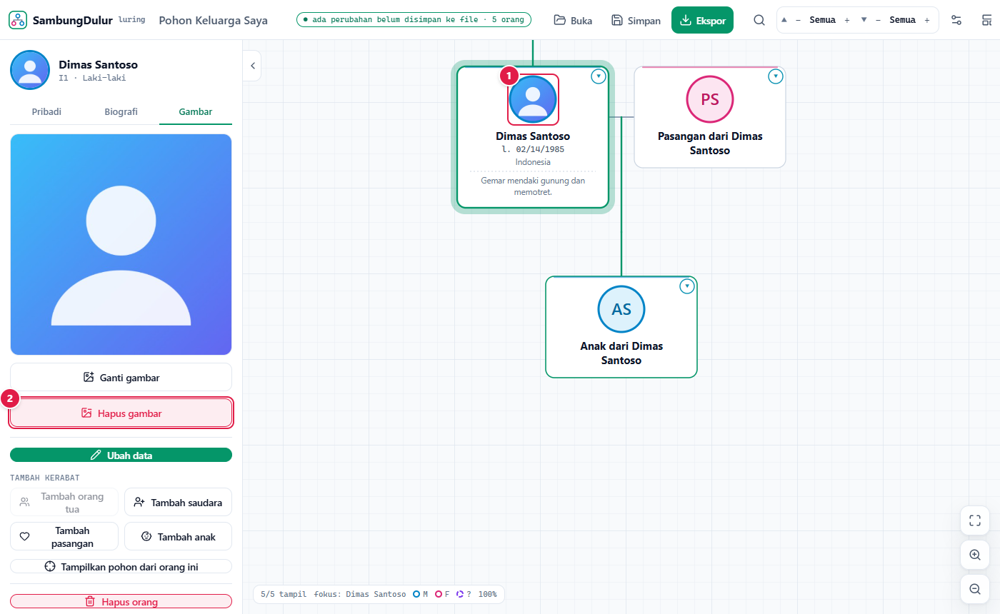

| No | Keterangan |
|---|---|
| 1 | Foto tampil di dalam cincin berwarna jenis kelamin. Tanpa foto, kartu menampilkan inisial. |
| 2 | **Hapus gambar** (dengan konfirmasi). **Ganti gambar** muncul menggantikan tombol Unggah. |

---

## 6. Menghapus orang (dan aturannya)

**Langkah:** pilih orang → **Hapus orang** → konfirmasi **Hapus**.

Aplikasi menolak dua keadaan, dengan penjelasan:
- **Orang terakhir** tidak bisa dihapus (pohon harus berisi minimal satu orang).
- Orang yang **menghubungkan dua bagian pohon** tidak bisa dihapus karena pohon akan terpecah. Hapus dulu orang di cabang terluar.

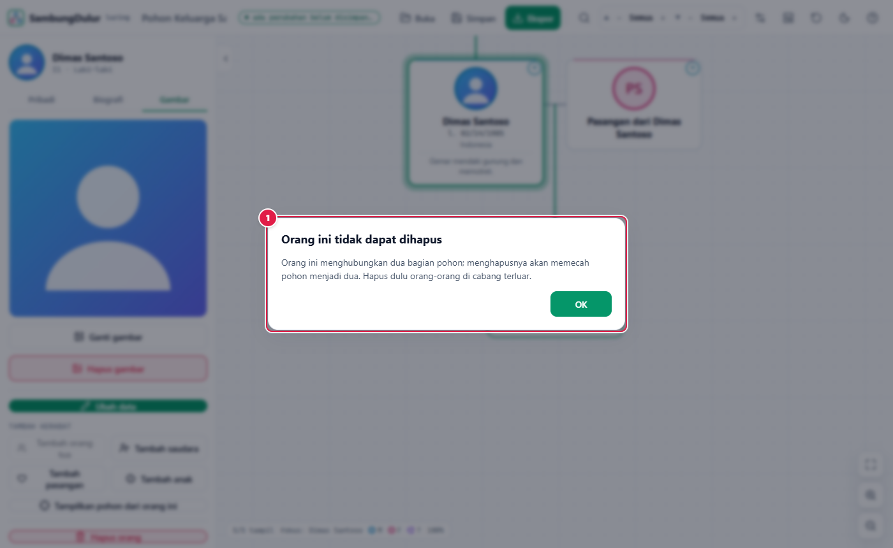

| No | Keterangan |
|---|---|
| 1 | Dialog penjelasan. Dalam contoh ini Dimas menghubungkan orang tuanya dengan pasangan dan anaknya, sehingga menghapusnya akan memecah pohon. Tekan **OK**, lalu hapus dulu cabang terluar (misalnya anak). |

---

## 7. Membuka berkas

Tekan **Buka**.

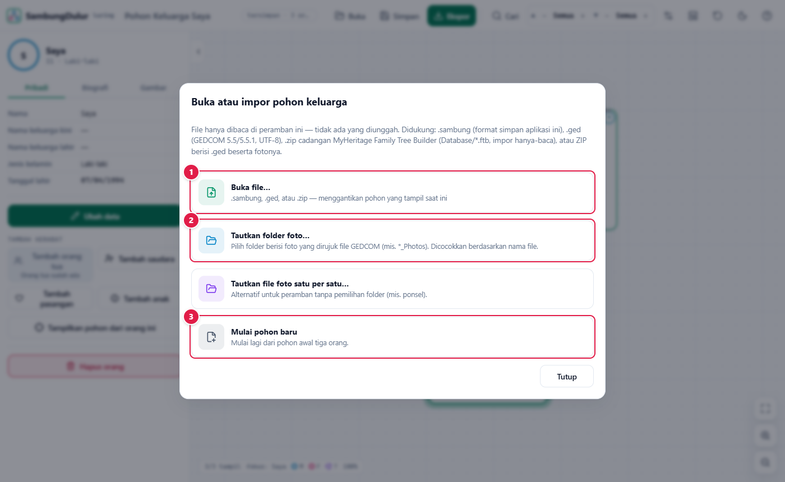

| No | Pilihan | Untuk |
|---|---|---|
| 1 | **Buka file…** | `.sambung` (simpanan aplikasi ini), `.ged` (GEDCOM 5.5/5.5.1, UTF-8), `.zip` cadangan MyHeritage Family Tree Builder (berisi `Database/*.ftb`), atau `.zip` berisi `.ged` dan foto. |
| 2 | **Tautkan folder foto…** | GEDCOM hanya menyimpan *lokasi* foto. Pilih folder fotonya (mis. `*_Photos`) dan foto dicocokkan lewat nama file. Tersedia juga *Tautkan file foto satu per satu* untuk browser tanpa pemilih folder. |
| 3 | **Mulai pohon baru** | Kembali ke pohon awal tiga orang. |

Pilih `keluarga-contoh.ged` (ada di `docs/demo`). Aplikasi menampilkan **laporan impor**:

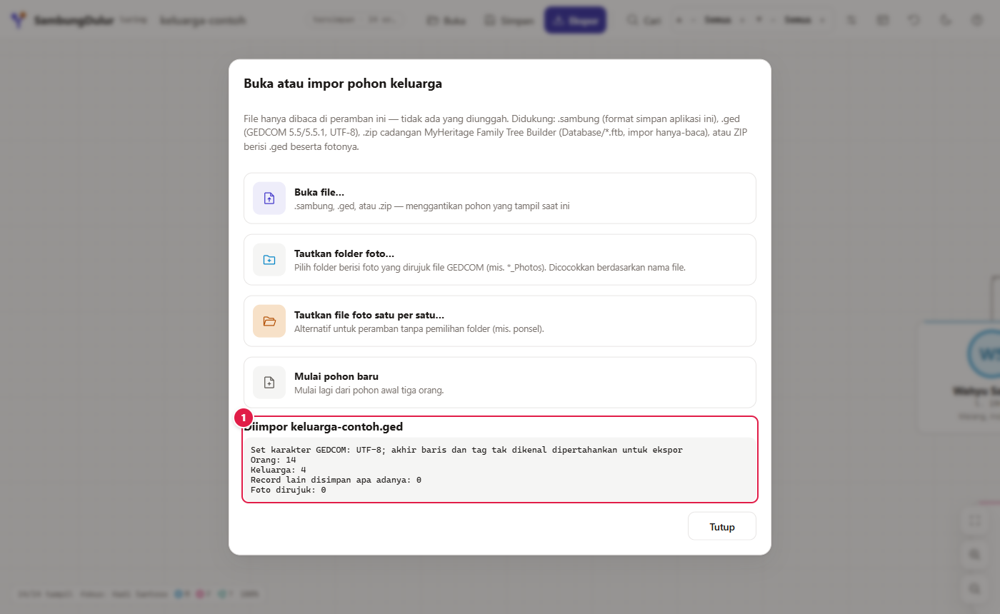

| No | Keterangan |
|---|---|
| 1 | Jumlah orang, keluarga, record lain yang disimpan apa adanya, dan jumlah foto yang dirujuk. Untuk cadangan MyHeritage `.zip`, laporan juga menyebut data yang **tidak** diimpor. |

**Hal penting tentang berkas**
- **GEDCOM dibuka secara lossless.** Tag yang tidak ditampilkan aplikasi (RESI, MARR, `_UID`, sumber, dll.) tetap ada dan ikut tertulis saat ekspor. Hanya bagian yang Anda ubah yang ditulis ulang.
- **`.ftb` hanya dibaca.** File MyHeritage tidak pernah diubah. Simpan hasil edit sebagai `.sambung` atau ekspor GEDCOM.
- File ANSEL tidak didukung. Ekspor ulang dari program asal sebagai UTF-8.

---

## 8. Menjelajah pohon besar

### Pohon lengkap

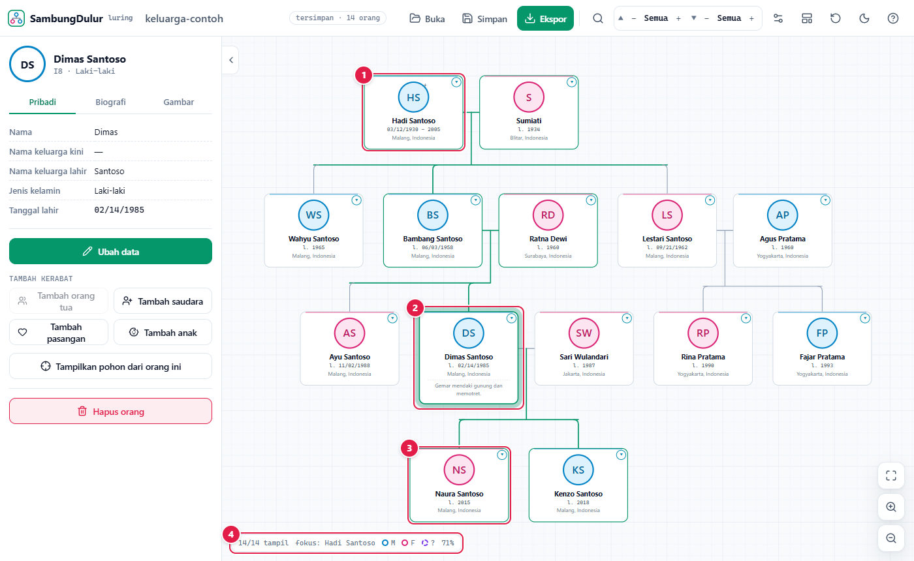

| No | Keterangan |
|---|---|
| 1 | Generasi paling atas (Hadi dan Sumiati). Tanda † pada cincin menandakan telah wafat. |
| 2 | **Orang terpilih** (Dimas): kartunya disorot dan garis ke leluhur serta keturunannya menyala hijau. |
| 3 | Keturunan di generasi paling bawah. |
| 4 | Penghitung: **14/14 tampil** (semua orang terlihat) dan fokus saat ini. |

Kartu punya tombol kecil: **▾** meringkas rincian kartu, **+/−** di tepi atas atau bawah membuka atau menutup cabang orang tua atau anak.

### Mengatur jumlah generasi

Untuk pohon besar, batasi generasi supaya kartu tetap terbaca.

**Langkah**
1. Pilih orang, tekan **Tampilkan pohon dari orang ini** (menjadikannya pusat pohon).
2. Atur ▲ (leluhur) dan ▼ (keturunan) dengan tombol **−** / **+**. Urutannya 0, 1, 2 … 10, lalu **Semua**.

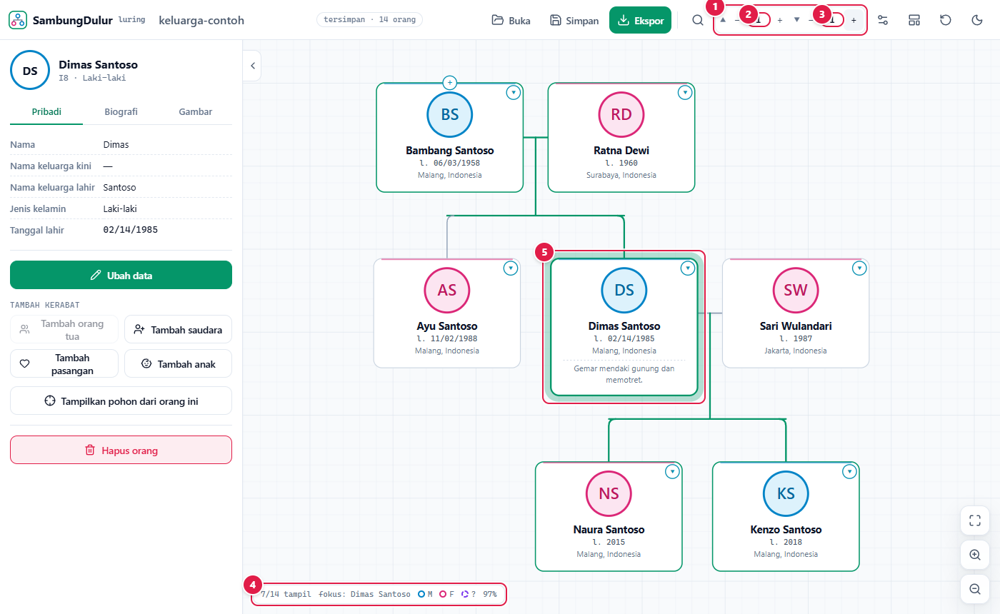

| No | Keterangan |
|---|---|
| 1 | Kontrol generasi. |
| 2 | **▲ 1** = satu generasi leluhur (orang tua Dimas, Bambang dan Ratna). |
| 3 | **▼ 1** = satu generasi keturunan (Naura dan Kenzo). |
| 4 | Penghitung menjadi **7/14 tampil**. |
| 5 | Dimas adalah orang fokus. Pasangan dan saudara ikut tampil. |

Pengaturan yang sama berlaku untuk **ekspor** bila Anda memilih *Tampilan saat ini*.

### Mencari orang

Tekan ikon kaca pembesar atau **Ctrl+F**.

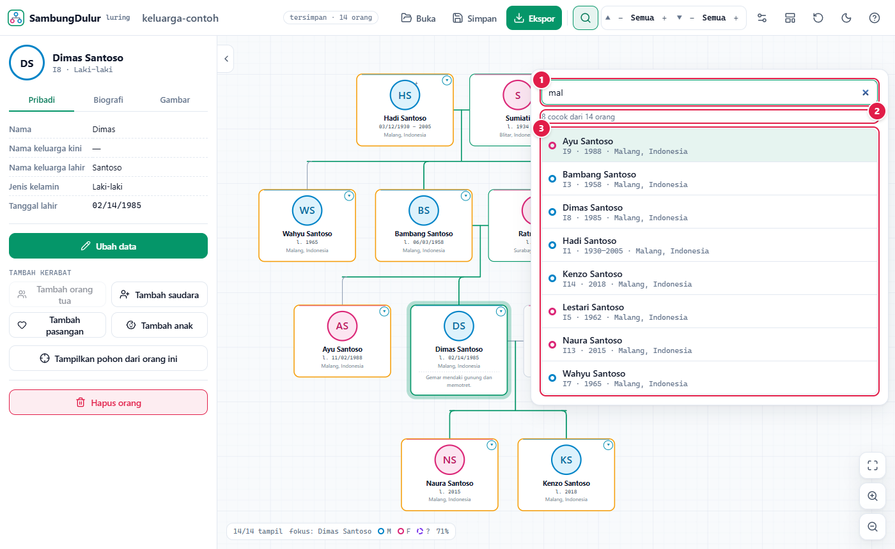

| No | Keterangan |
|---|---|
| 1 | Ketik sebagian nama, tahun, tempat, pekerjaan, atau ID. Semua kata harus cocok; huruf besar-kecil dan tanda aksen diabaikan. Contoh `mal` menemukan semua orang kelahiran Malang. |
| 2 | Jumlah hasil dari total orang. |
| 3 | Daftar hasil dengan bagian yang cocok disorot. Gunakan **↑ ↓** lalu **Enter**, atau klik. |

Memilih hasil memusatkan kanvas pada orang itu. Bila orang tersebut berada di luar generasi yang sedang tampil, pohon dipindahkan agar ia menjadi pusat.

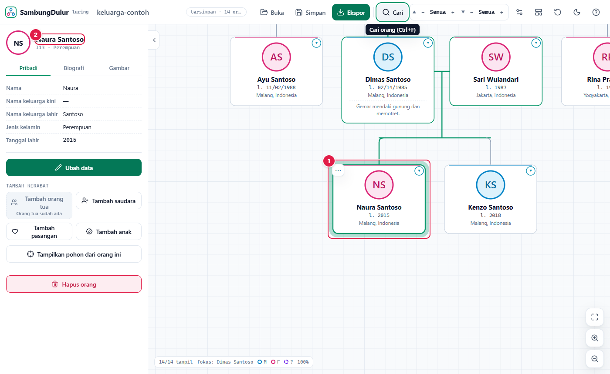

| No | Keterangan |
|---|---|
| 1 | Kartu hasil pencarian (Naura) dipusatkan dan diberi warna sorotan. |
| 2 | Datanya langsung terbuka di panel kiri. **Esc** menghapus sorotan pencarian. |

---

## 9. Mengatur tampilan

Tekan ikon **Pengaturan pohon** (geser-geser).

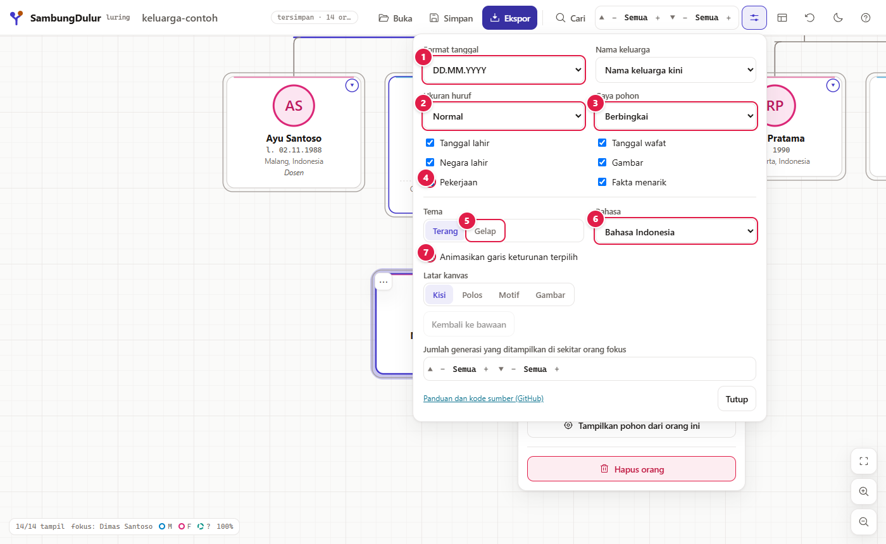

| No | Pengaturan | Pilihan |
|---|---|---|
| 1 | **Format tanggal** | `MM/DD/YYYY`, `MM.DD.YYYY`, `DD/MM/YYYY`, `DD.MM.YYYY`, `YYYY` |
| 2 | **Ukuran huruf** | Kecil, Normal, Besar. Pada **Besar**, *Pekerjaan* dan *Fakta menarik* otomatis dinonaktifkan. |
| 3 | **Gaya pohon** | **Polos** atau **Berbingkai** (bingkai ganda di sekeliling kartu, terlihat pada gambar). |
| 4 | **Kolom kartu** | Tanggal lahir, tanggal wafat, negara lahir, gambar, pekerjaan, fakta menarik. Mematikan *Tanggal lahir* ikut mematikan *Tanggal wafat*. |
| 5 | **Tema** | Terang atau Gelap. |
| 6 | **Bahasa** | Indonesia, Jawa, atau Inggris. |
| 7 | **Animasikan garis keturunan terpilih** | Garis ke leluhur dan keturunan orang terpilih bergerak pelan (otomatis mati bila sistem meminta *reduced motion*). |

Di dalam menu ini juga ada kontrol **Generasi**, selain di toolbar. Pengaturan disimpan bersama pohon.

### Tema gelap

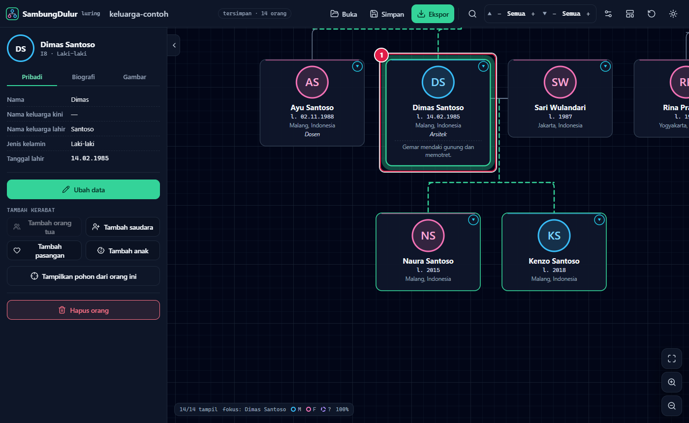

| No | Keterangan |
|---|---|
| 1 | Kartu orang terpilih dengan garis keturunan yang menyala. |
| 2 | Cincin perempuan (magenta) dan laki-laki (biru) tetap mudah dibedakan di tema gelap. |

Tombol bulan/matahari di toolbar mengganti tema dengan cepat.

---

## 10. Tata letak manual

Susunan kartu dihitung otomatis. Bila ingin menyesuaikan:

**Langkah**
1. Tekan **Tata Letak Manual** di toolbar.
2. Baca penjelasan, tunggu hitung mundur selesai, tekan **Lanjut**. (Penjelasan hanya muncul pada penggunaan pertama.)
3. Seret **pegangan ↔** di atas kartu untuk menggeser orang ke kiri atau kanan.
4. Seret **titik bulat** pada garis keluarga untuk menggeser garis naik atau turun.
5. Tekan **Simpan** untuk menerapkan, atau **Batal** untuk membuang.

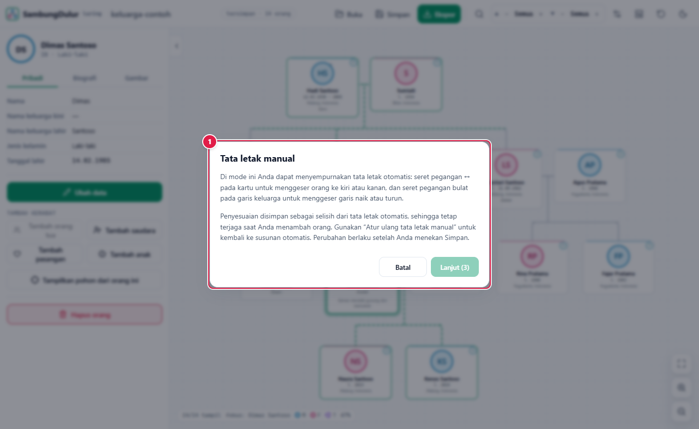

| No | Keterangan |
|---|---|
| 1 | Dialog penjelasan. Tombol **Lanjut** aktif setelah hitung mundur 3 detik. |

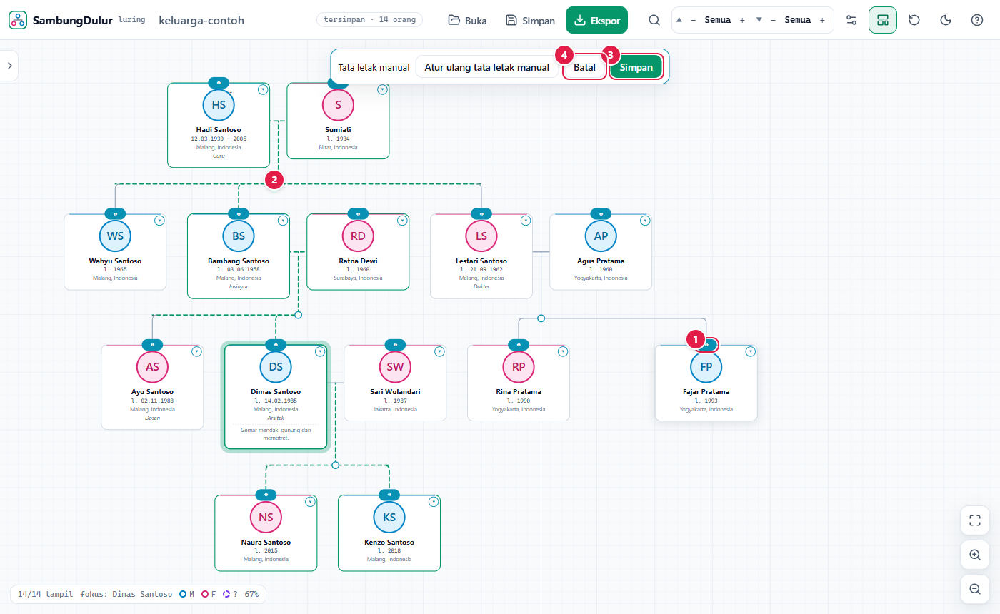

| No | Keterangan |
|---|---|
| 1 | Pegangan **↔** pada kartu. Pada gambar, Fajar sudah digeser ke kanan (kartunya terangkat dan garis ikut menyesuaikan). |
| 2 | **Titik kontrol** garis keluarga: seret ke atas/bawah. |
| 3 | **Simpan**: nonaktif sampai ada perubahan. |
| 4 | **Batal**: kembali ke posisi sebelumnya. |

Panel editor disembunyikan selama mode ini supaya tidak ada perubahan data yang bercampur. **Atur ulang tata letak manual** (di bilah atas) menghapus semua penyesuaian. Penyesuaian disimpan sebagai *selisih dari tata letak otomatis*, jadi tetap berlaku ketika Anda menambah orang kemudian.

---

## 11. Menyimpan dan mengekspor

### Simpan: format yang bisa dibuka ulang

Tekan **Simpan** (atau **Ctrl+S**). Browser mengunduh `<judul>.sambung`, berisi pohon, pengaturan, tata letak manual, foto, dan GEDCOM sumber (bila pohon berasal dari GEDCOM). Buka kembali lewat **Buka → Buka file…**: hasilnya persis seperti saat disimpan.

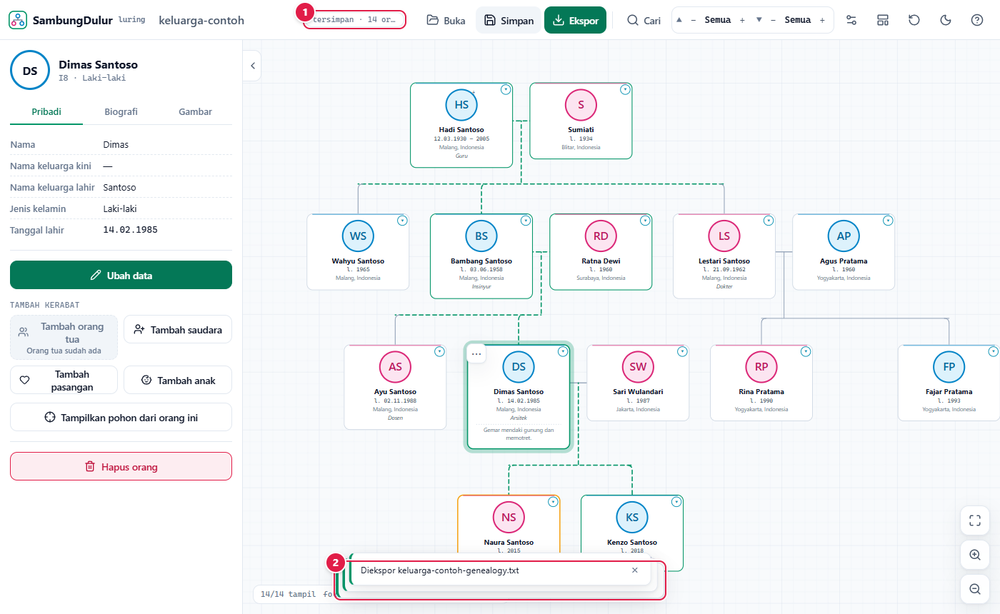

| No | Keterangan |
|---|---|
| 1 | Penanda status: *tersimpan* berarti tidak ada perubahan yang belum ditulis ke file. Bila tertulis *● ada perubahan belum disimpan ke file*, browser akan memperingatkan sebelum Anda menutup tab. |
| 2 | Pemberitahuan singkat di bawah layar. |

> Salinan kerja juga disimpan otomatis di browser (IndexedDB), sehingga reload atau menutup browser tidak menghilangkan pekerjaan. Itu **bukan** pengganti file: bersihkan data situs, dan salinannya hilang. Simpan `.sambung` secara berkala.

### Ekspor

Tekan **Ekspor**.

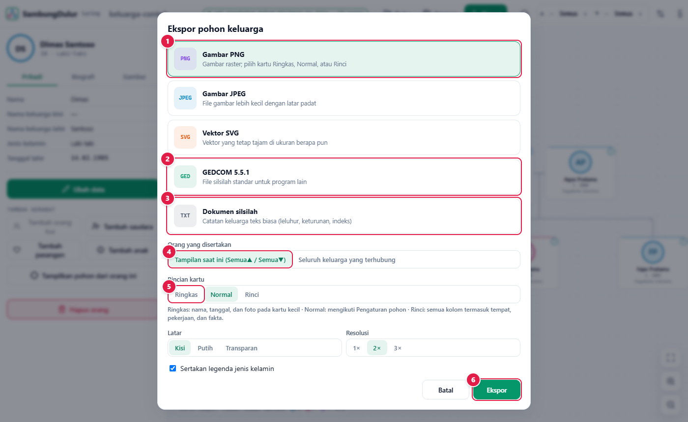

| No | Pilihan | Hasil |
|---|---|---|
| 1 | **Gambar PNG** | Gambar pohon. Juga tersedia **JPEG** (latar padat) dan **SVG** (vektor). |
| 2 | **GEDCOM 5.5.1** | `.ged` untuk program silsilah lain; opsi ZIP berisi folder `media/` untuk foto. |
| 3 | **Dokumen silsilah** | File teks biasa: leluhur bernomor, keturunan bertingkat, indeks nama. |
| 4 | **Orang yang disertakan** | *Tampilan saat ini* (mengikuti kontrol generasi) atau *Seluruh keluarga yang terhubung*. |
| 5 | **Rincian kartu** (untuk gambar) | **Ringkas / Normal / Rinci** (lihat di bawah). |
| 6 | **Ekspor** | Mengunduh file. |

Pengaturan gambar lain: **Latar** (Kisi, Putih, Transparan; JPEG selalu padat), **Resolusi** 1×–3× (otomatis diturunkan bila melebihi batas kanvas browser), dan **legenda jenis kelamin**.

#### PNG: Ringkas, Normal, Rinci

Ketiganya adalah ekspor `Seluruh keluarga yang terhubung` dari pohon contoh.

**Ringkas**: kartu kecil, hanya nama, tanggal, dan foto. Cocok untuk melihat bentuk pohon besar.

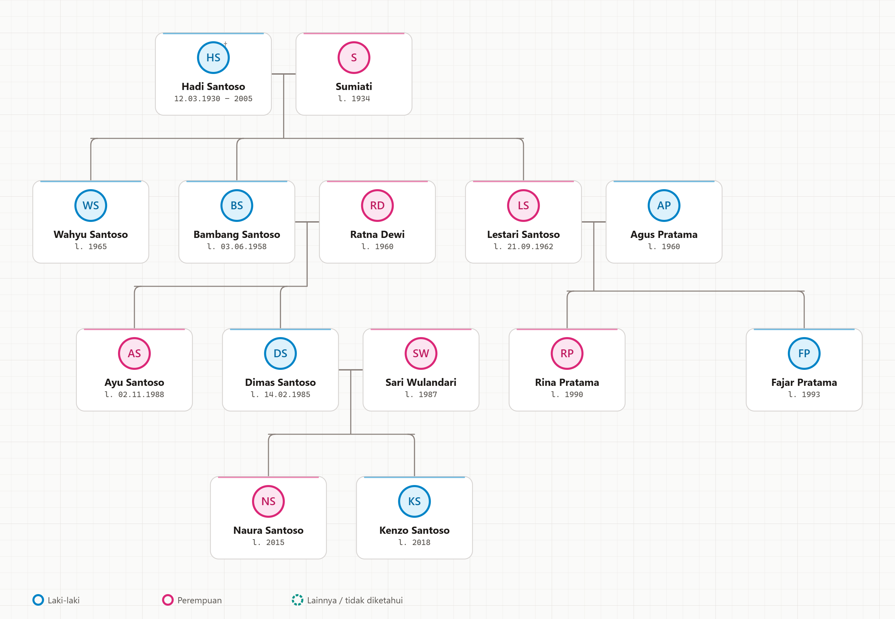

**Normal**: mengikuti *Pengaturan pohon* (kolom dan ukuran huruf yang sedang Anda pakai).

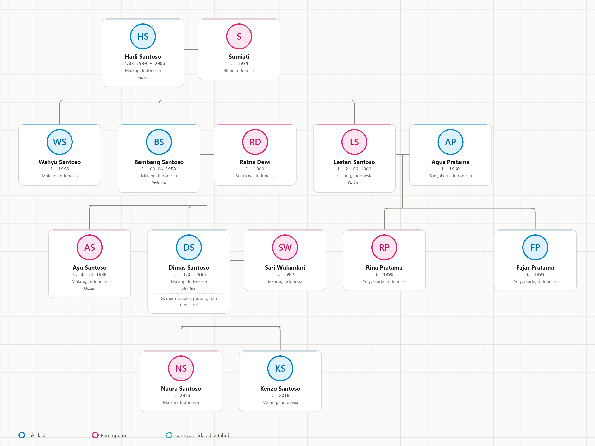

**Rinci**: semua kolom (tempat, pekerjaan, fakta) pada kartu lebih lebar. Cocok untuk dicetak.

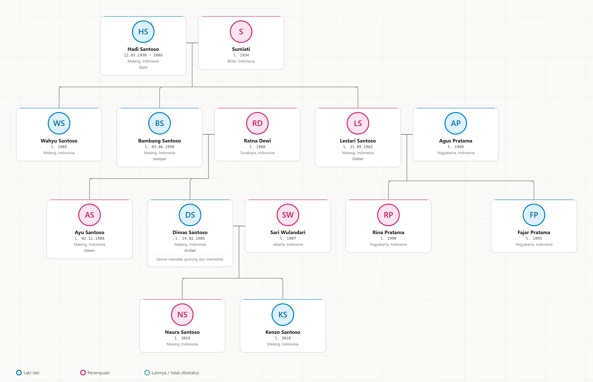

#### GEDCOM dan dokumen teks

- Bila pohon berasal dari GEDCOM, ekspor **menulis ulang hanya orang dan keluarga yang Anda ubah**. Selebihnya identik byte-per-byte dengan file asal, termasuk tag yang tidak ditampilkan aplikasi.
- Contoh hasil: [`demo/contoh-ekspor.ged`](demo/contoh-ekspor.ged) dan [`demo/contoh-dokumen-silsilah.txt`](demo/contoh-dokumen-silsilah.txt).

---

## 12. Bahasa

Bahasa bawaan adalah **Indonesia**. Pilih **Basa Jawa** atau **English** di *Pengaturan pohon → Bahasa* (di layar lebar ≥1600 px juga ada pemilih di toolbar, dan di ponsel ada di menu ⋯).

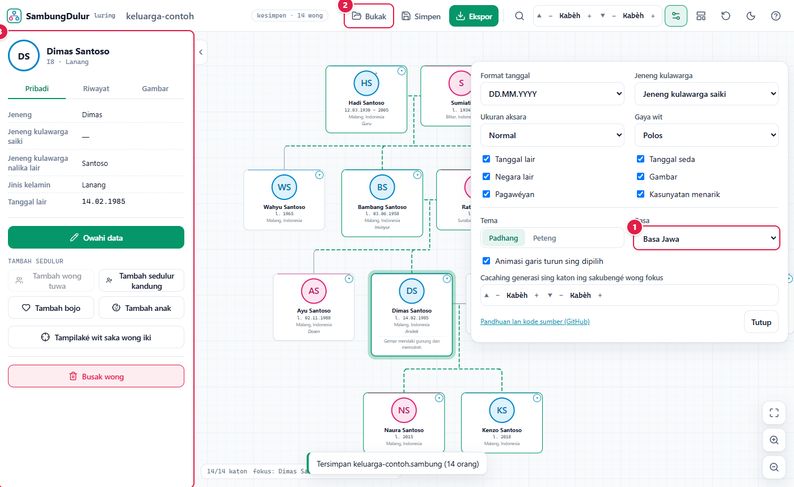

| No | Keterangan |
|---|---|
| 1 | Pemilih bahasa. Pilihan diingat untuk kunjungan berikutnya. |
| 2 | Seluruh label berganti: **Bukak**, **Simpen**, **Ekspor**. |
| 3 | Panel editor, pesan, nama otomatis ("Bapakné …", "Bojoné …"), nama bulan, dan teks dokumen silsilah mengikuti bahasa yang dipilih. |

Bahasa hanya mengubah tampilan; data keluarga Anda tidak berubah.

---

## 13. Di ponsel, dan memasang sebagai aplikasi

Pada layar sempit (≤760 px) tampilan menyesuaikan diri: panel editor menjadi **panel bawah**, dan alat sekunder pindah ke menu **⋯**.

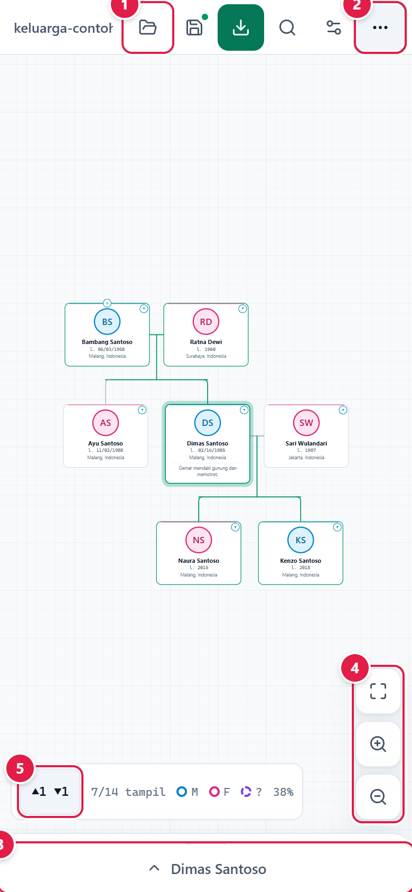

| No | Keterangan |
|---|---|
| 1 | **Buka**, **Simpan**, **Ekspor**, **Cari**, **Pengaturan**, dan **⋯** selalu terlihat di bilah atas. |
| 2 | Menu **⋯**: kontrol generasi, bahasa, tata letak manual, tema, atur ulang. |
| 3 | Panel bawah **Penyunting**. Ketuk untuk membuka/menutup. |
| 4 | Pusatkan, perbesar, perkecil. Cubit dengan dua jari untuk zoom. |
| 5 | Penghitung orang tampil. |

Di ponsel, batasi generasi (mis. ▲1 ▼1) supaya kartu terbaca, seperti pada gambar ini.

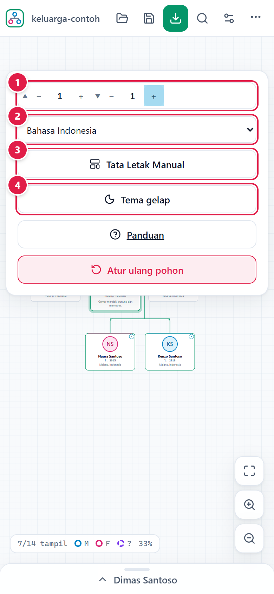

| No | Keterangan |
|---|---|
| 1 | Kontrol generasi ▲ (leluhur) dan ▼ (keturunan). |
| 2 | Bahasa. |
| 3 | Tata letak manual. |
| 4 | Ganti ke tema gelap. |

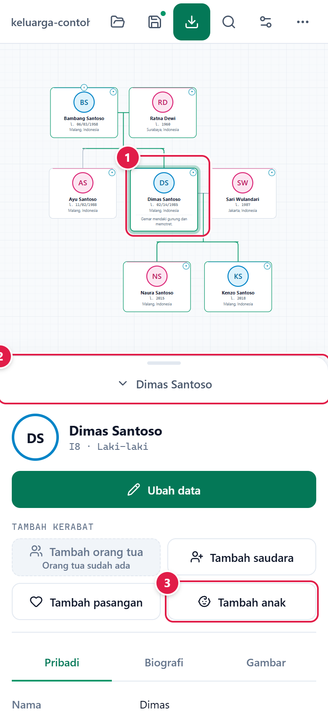

| No | Keterangan |
|---|---|
| 1 | Ketuk sebuah kartu: panel bawah terbuka berisi data orang itu. |
| 2 | **Ubah data**, **Tambah kerabat**, dan **Hapus orang** bekerja seperti di desktop. |
| 3 | Ketuk batang atas panel untuk menutupnya dan kembali melihat pohon. |

### Memasang dan memakai tanpa internet

1. Buka aplikasi sekali saat online. Service worker menyimpan semua file aplikasi.
2. Pasang (bagian 1). Aplikasi muncul di daftar program/layar utama dan terbuka tanpa bilah alamat.
3. Setelah itu, aplikasi berjalan **tanpa internet**: buka, edit, simpan, dan ekspor semuanya terjadi di perangkat.

---

## 14. Tips dan pemecahan masalah

| Masalah | Penyebab / solusi |
|---|---|
| Foto tidak muncul setelah membuka GEDCOM | GEDCOM hanya mencatat lokasi foto. Pakai **Buka → Tautkan folder foto…**. Foto yang belum tertaut ditandai di panel *Gambar*. |
| "Tambah orang tua" nonaktif | Orang itu sudah punya orang tua. |
| Tidak bisa menghapus seseorang | Aturan hapus (bagian 6). Hapus cabang terluar lebih dulu. |
| Pohon terlalu kecil/rapat | Kurangi generasi, atau pakai **Pusatkan**. Untuk ekspor, pakai preset **Ringkas** atau SVG. |
| Ekspor PNG gagal pada pohon sangat besar | Batas kanvas browser. Kurangi generasi atau ekspor **SVG**. |
| Karakter GEDCOM tampak rusak | Berkas bukan UTF-8. Aplikasi membaca sebagai Windows-1252 dan memberi peringatan. Ekspor ulang sebagai UTF-8 dari program asal. |
| Pekerjaan/fakta tidak tampil di kartu | Ukuran huruf **Besar** menyembunyikannya, atau kolomnya dimatikan di Pengaturan pohon. |
| Data hilang setelah membersihkan data situs | Salinan kerja ada di penyimpanan browser. Selalu simpan `.sambung` atau ekspor GEDCOM sebagai cadangan. |

**Batasan yang perlu diketahui**
- Kolom GEDCOM yang bisa diedit: nama, jenis kelamin, kelahiran (tanggal/tempat), kematian, pekerjaan, catatan pertama, foto utama, dan relasi keluarga. Lainnya dipertahankan tetapi tidak bisa diedit.
- Berkas MyHeritage `.ftb` hanya bisa **diimpor** (hanya-baca); fakta seperti tempat tinggal, pemakaman, dan pernikahan belum ikut diimpor.
- Selengkapnya ada di bagian *Batasan format* pada [README](../README.md).

---

*Mengulang pembuatan gambar panduan:* `npm run build`, jalankan `npx vite preview --port 4173`, lalu `npm run docs`. Skrip `scripts/make-docs.mjs` mengendalikan aplikasi dengan Edge, memakai data fiktif di `docs/demo`, dan menggambar penanda bernomor pada tiap screenshot.
