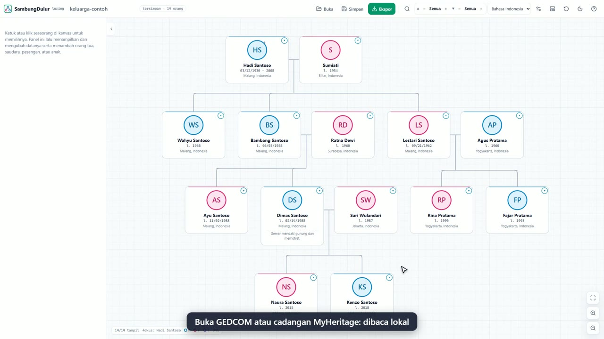

# Video demo SambungDulur

[](sambungdulur-demo.mp4)

**[▶ Tonton `sambungdulur-demo.mp4`](sambungdulur-demo.mp4)** (3 menit 20 detik, 1080p, ±13 MB, bahasa Indonesia, subtitle terpisah: [`sambungdulur-demo.id.srt`](sambungdulur-demo.id.srt))

Video merekam **aplikasi sungguhan** (bukan animasi) dengan data fiktif keluarga Santoso. Narasi dibacakan suara **Microsoft Andika** (id-ID, laki-laki).

## Bab

| Bab | Isi |
|---|---|
| 1 | Pembuka: tanpa akun, tanpa server, tanpa unggah |
| 2 | Mengenal layar dan arti warna cincin foto |
| 3 | Ubah data, tambah pasangan dan anak |
| 4 | Foto dalam lingkaran |
| 5 | Buka GEDCOM / cadangan MyHeritage |
| 6 | Atur generasi dan cari orang (Ctrl+F) |
| 7 | Pengaturan, tema gelap, tata letak manual |
| 8 | Simpan `.sambung`, ekspor GEDCOM, PNG, dokumen teks |
| 9 | Bahasa dan tampilan ponsel |
| 10 | Penutup |

Naskah lengkap dan urutan adegan: [`../VIDEO_NARASI.md`](../VIDEO_NARASI.md). Panduan tertulis dengan screenshot: [`../PANDUAN.md`](../PANDUAN.md).

## Membuat ulang video

Video dihasilkan otomatis, jadi dapat dibuat ulang setiap kali tampilan aplikasi berubah.

Prasyarat: Windows dengan suara **Microsoft Andika** (Pengaturan → Waktu & bahasa → Wicara → Kelola suara), PowerShell 7 (`pwsh`), Node.js 22+, ffmpeg di PATH, dan Microsoft Edge.

```bash
npm install
npx playwright install ffmpeg              # sekali saja, untuk merekam video
npm run build
npx vite preview --port 4173 &             # aplikasi yang direkam
pwsh -NoProfile -File scripts/video/tts.ps1 scripts/video/scenes.json temp/video/audio
node scripts/video/record.mjs              # merekam, memasang audio, menulis docs/video/*
```

| Berkas | Peran |
|---|---|
| `scripts/video/scenes.json` | Naskah per adegan: teks subtitle (`text`), teks yang dibaca suara (`speak`, istilah asing dieja fonetis), keterangan di layar (`caption`) |
| `scripts/video/tts.ps1` | Sintesis suara Andika lewat SAPI, **sepenuhnya lokal** |
| `scripts/video/record.mjs` | Menjalankan aplikasi, menyelaraskan tiap aksi dengan kalimat narasi, menggabungkan audio dan subtitle |

Mengganti kata-kata: ubah `scenes.json`, jalankan ulang `tts.ps1`, lalu `record.mjs`. Aksi di layar ada di `record.mjs` (satu fungsi per adegan).

> **Catatan suara:** suara Microsoft Andika adalah bagian dari Windows. Periksa ketentuan lisensi Microsoft bila video dipakai untuk keperluan komersial. Kode dalam repositori ini berlisensi MIT, sedangkan hasil suara tunduk pada ketentuan penyedia suara.
